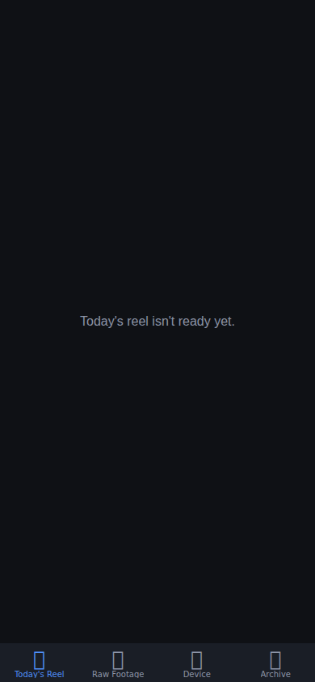
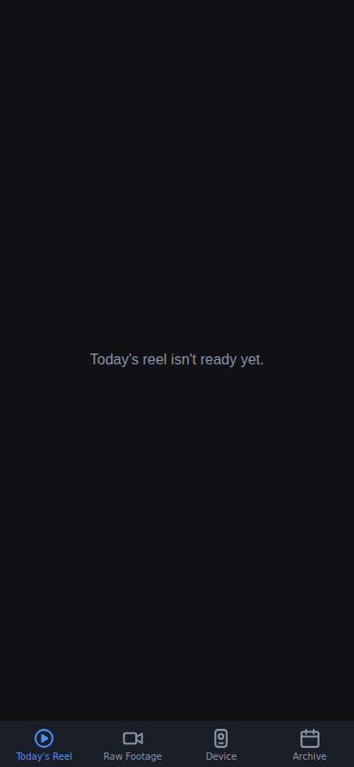
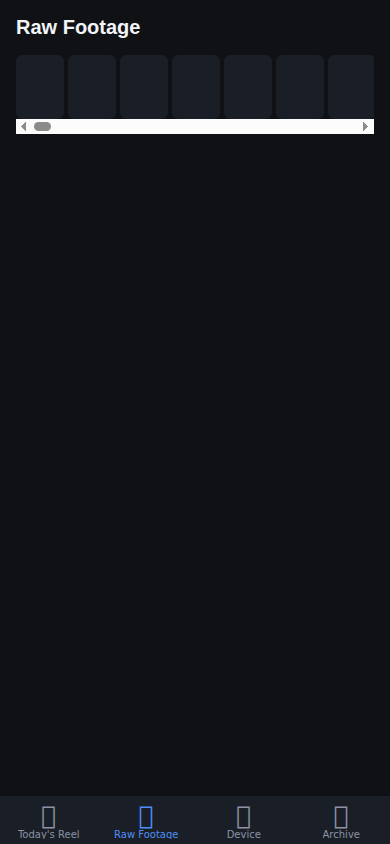
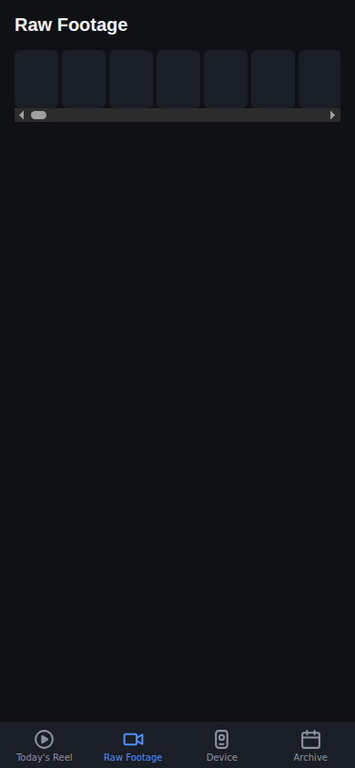
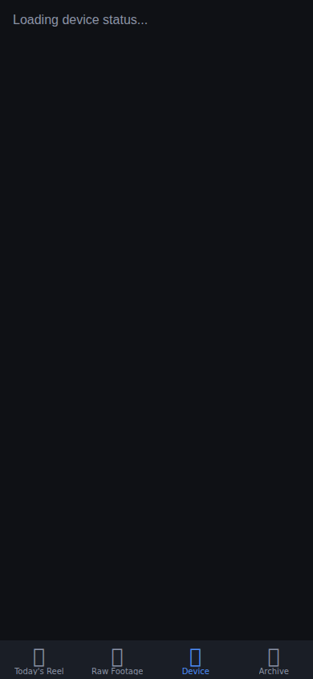
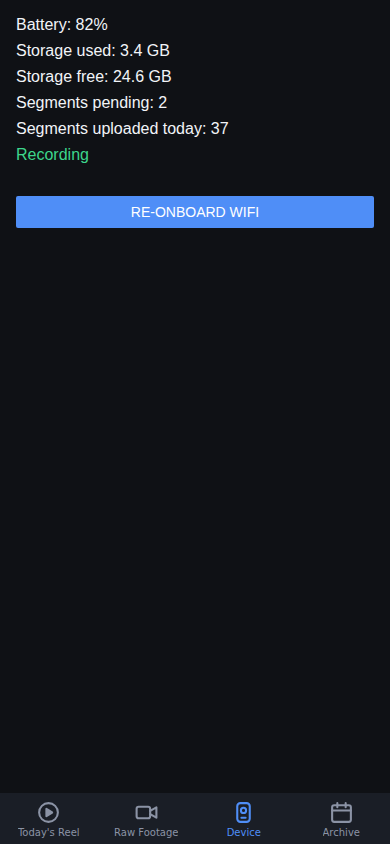
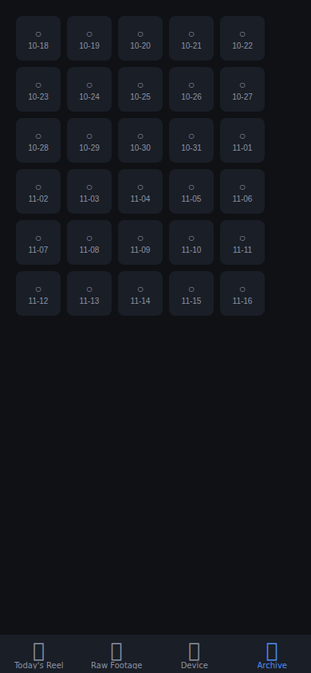
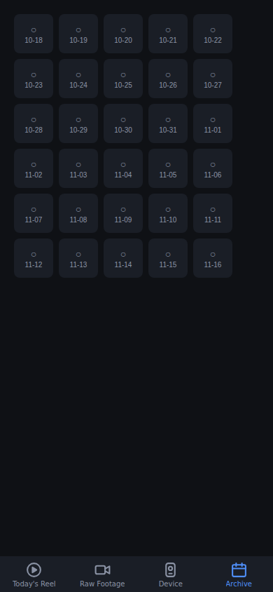

# Web tab-bar icons - evidence

Captured with `npx expo start --web` against the local Supabase stack, signed in as a seeded user with one device and a `device_status` row, in headless Chrome at 390x844.

## Root cause

No `Tab.Screen` set a `tabBarIcon`.
`@react-navigation/bottom-tabs` 7.18.7 then renders its `MissingIcon` fallback, the text glyph U+23F7, which the web font stack (`system-ui`, then Times New Roman as measured in the browser) has no glyph for.
The accessibility tree before the fix read `tab "⏷ ⏷ Today's Reel"` for every tab (the icon renders twice to cross-fade active and inactive).
This was not a font-loading problem: the app never imported an icon font, so there was nothing for `expo-font` to preload.

## Fix

- SVG icons via the already-installed `react-native-svg`, so no icon font, no `useFonts` preload, and no first-frame flash on any platform.
- Two adjacent defects visible in the same screenshots, each its own commit:
  - Tab labels clipped "y" and "g": web's 48px bar left the label 2px short, so flex-shrink squeezed it under its `overflow: hidden`. Labels now have `lineHeight: 14` and `flexShrink: 0`, and the web bar is 52px. Native keeps the library's safe-area-aware height.
  - The Raw Footage timeline scrollbar was a white bar: the document defaulted to a light color scheme. Web now sets `color-scheme: dark`.

## Screenshots

| Tab | Before | After |
| --- | --- | --- |
| Today's Reel |  |  |
| Raw Footage |  |  |
| Device |  |  |
| Archive |  |  |

The Device "before" shows "Loading device status..." because the `device_status` row was seeded after that capture; that is the intended first-boot state, not part of this defect.

## Checks

`verify.log` holds `tsc --noEmit`, the full `jest --ci` run (33 suites, 130 tests, live Supabase suite included) and `expo export --platform web`.
`after-tabs-a11y.txt` is the accessibility tree of the tab bar after the fix: no U+23F7 glyph.
