# Demo mode - evidence

Captured with `npx expo start --web` against a local Supabase stack seeded by `python -m pipeline.demo --placeholder` (stub scoring, the real nightly pipeline), in headless Chrome through `chrome-devtools-axi`.
Every screen was reached by tapping **View demo** on the sign-in screen, then each tab in turn.

The stack ran under its own project id on ports 553xx rather than the default 543xx: this project's default-port stack was holding another branch's unmerged migration, and resetting it would have destroyed that state.
The app, the seed and the tests do not depend on the port.

## Screens

| Screen | 390 px | Desktop (1280x800) |
| --- | --- | --- |
| Sign in, with View demo | 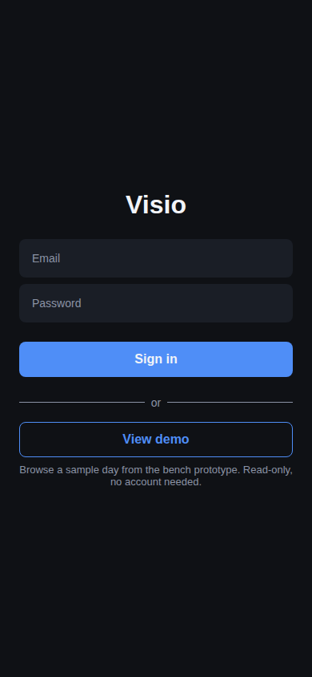 | 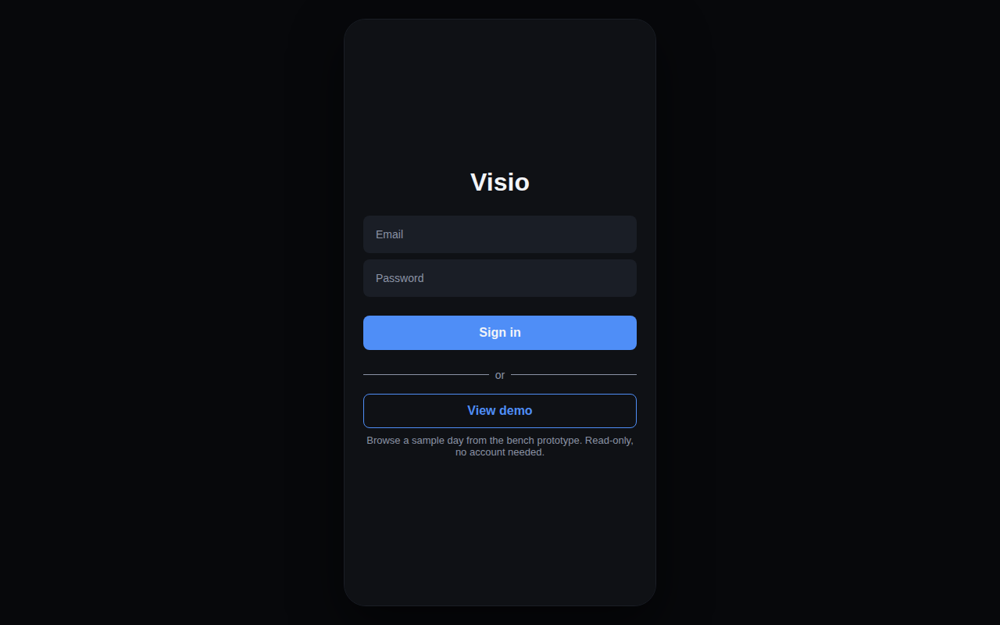 |
| Today's Reel (the sample reel, mid-playback) | 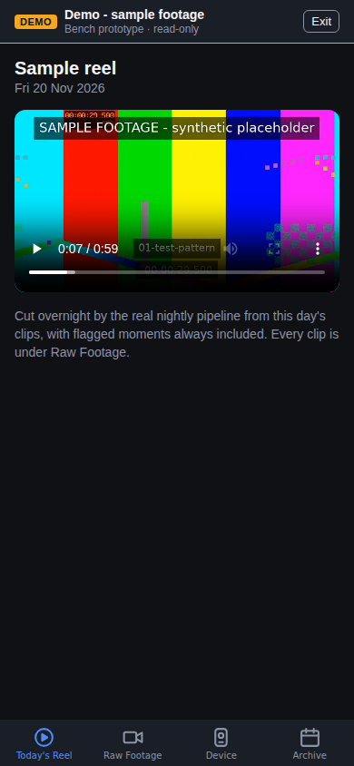 | 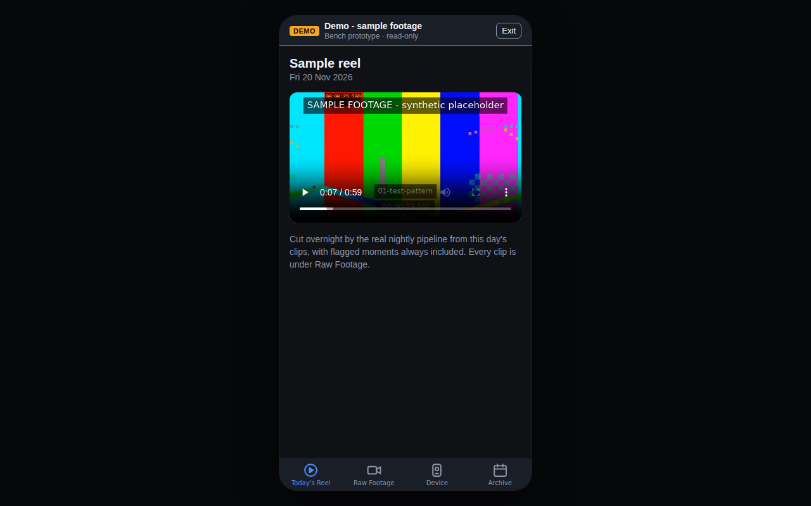 |
| Raw Footage | 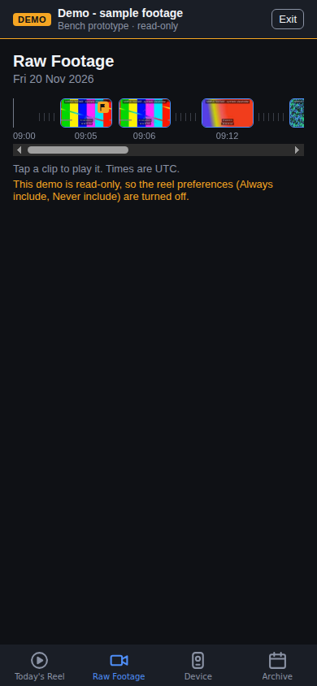 | 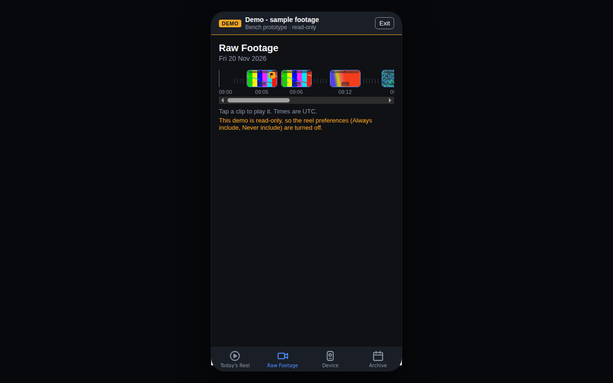 |
| Raw Footage, a flagged clip playing | 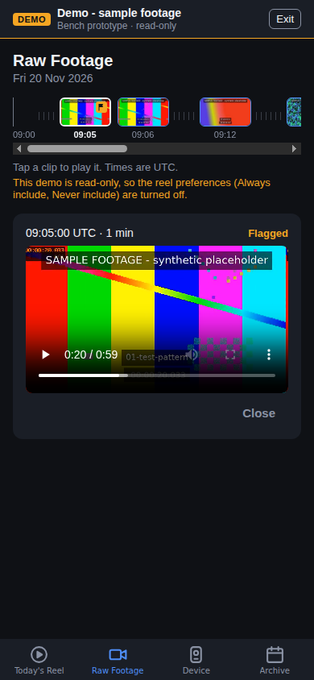 | 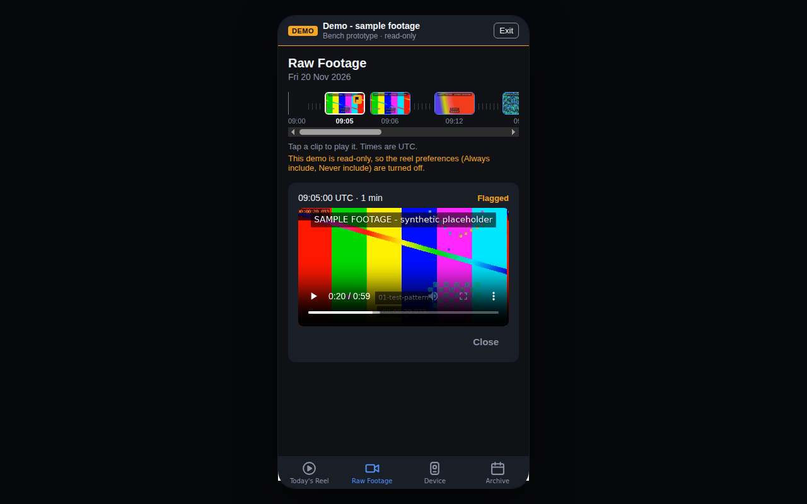 |
| Device, Wi-Fi setup disabled | 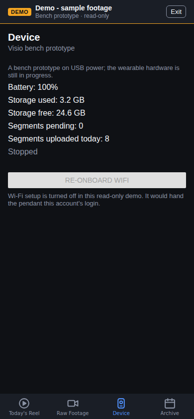 | 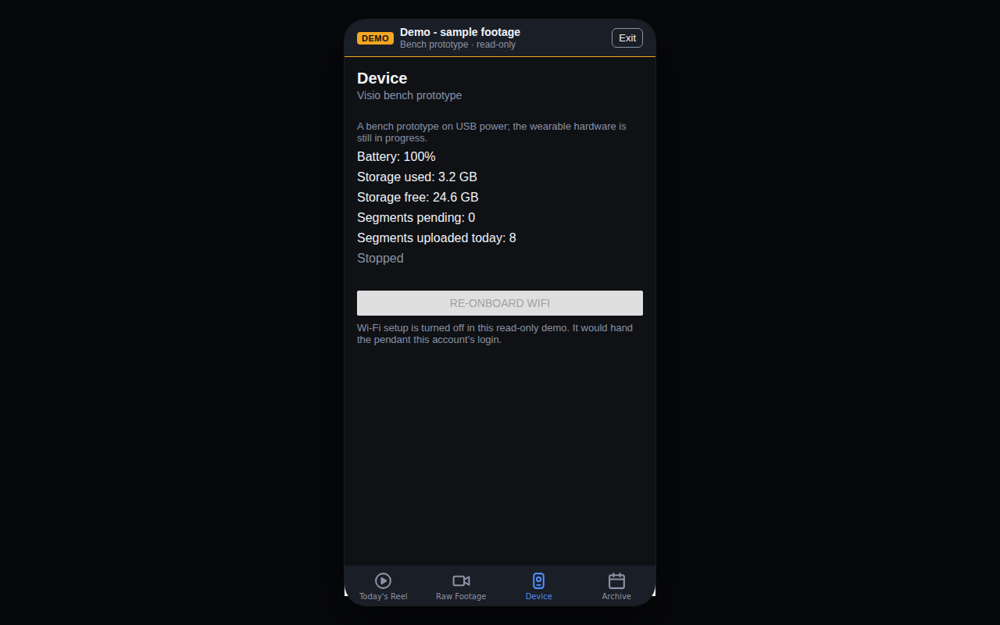 |
| Archive | 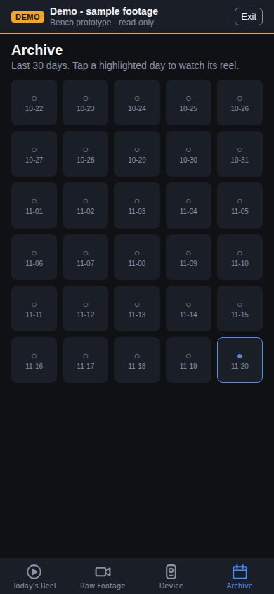 | 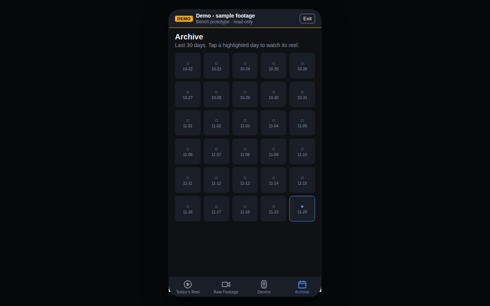 |
| Archive, the day's reel | 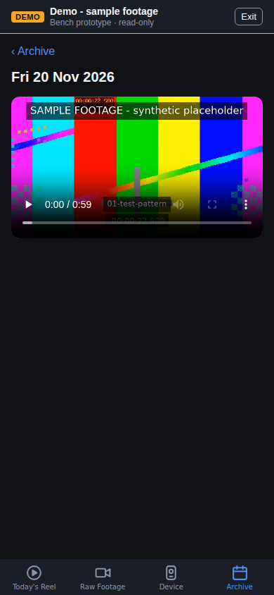 | 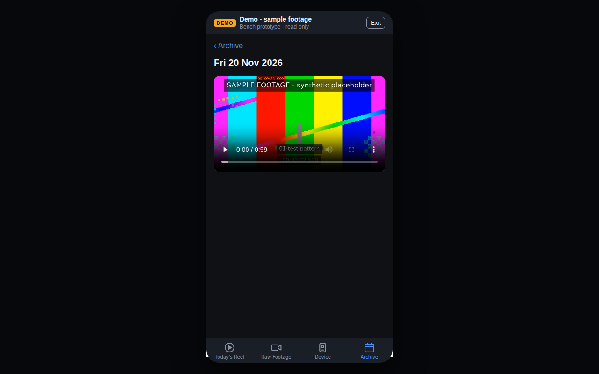 |

## The reel plays

[`playback.txt`](playback.txt): every video the demo mounts was played in the browser and advanced, at 1280x720, with no media error.
The reel screen no longer sits on "Preparing playback..." when signing fails or a reel has no file; it says which.

## Writes are refused by the database

[`browser-write-attempts.txt`](browser-write-attempts.txt) is the demo session in the same browser calling the REST, Storage and Auth APIs directly with its own token, bypassing the app.
Inserts are rejected by the `*_read_only_insert` policies, updates and deletes match no row, the upload is refused by the storage policy, and the password change is refused by the `auth.users` trigger; the device row is unchanged afterwards.

## Fixed on the way

Each predates this change and was visible in the demo:

- Raw Footage bucketed one-minute segments into five-minute slots, so four of every five segments of a recording run were hidden, and the strip opened at midnight; it now has one-minute slots trimmed to the recorded hours, a time under every clip and hour labels.
- Raw Footage on web could not open a clip at all: it only had a long-press menu built on `Alert`, which react-native-web does not implement. A tap now plays the clip.
- Timeline thumbnails were never drawn on web; a `<video>` and `<canvas>` now draw them.
- The reel player was a 9:16 box for 16:9 footage.
- Share and Save rejected or did nothing on desktop web; they are hidden where the platform cannot do them.
- A reel kept playing, with sound, after switching tabs.
- The Device tab said "Paused" where the PRD says "Stopped", and Device and Archive had no heading.
- The Archive grid left a ragged gap on the right at phone width, and its Back button sat at the bottom of the screen.
