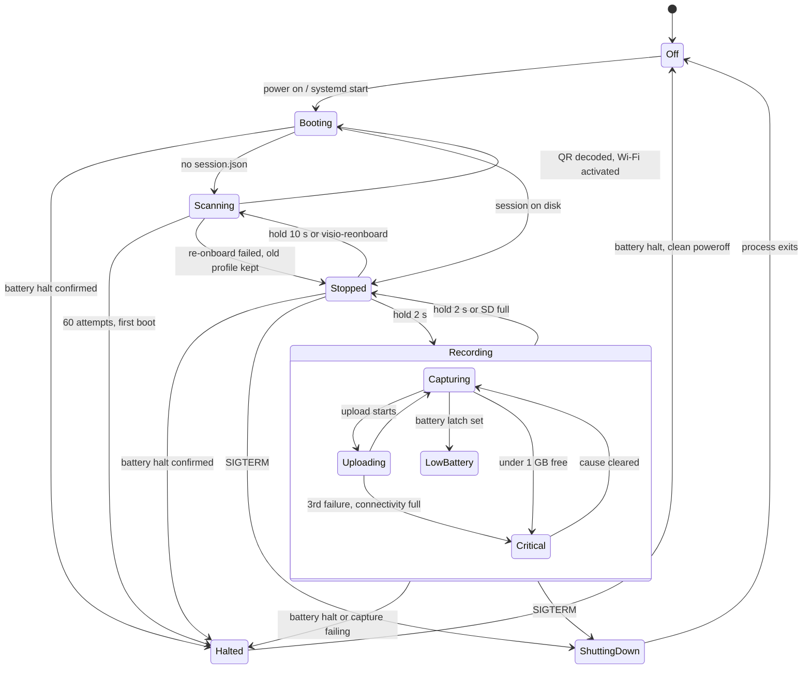

# Visio Pendant - Design Spec

**Date:** 2026-07-04
**Status:** Approved
**Project dir:** `/home/viet/git/vision`

---

## Overview

Visio is a cheap wearable pendant AI life-logger for home and personal vlogging use.
It is inspired by looki.ai but targets a DIY maker audience using off-the-shelf embedded components.
The device records passively all day, uploads footage to the cloud over home WiFi, and an AI pipeline assembles a 60-120 second highlight reel automatically each night.

---

## Goals

- Total hardware BOM under $110.
- Full-day (7-8 hr) passive recording without user interaction.
- Nightly AI-generated highlight reel delivered via push notification.
- Vintage / nostalgic aesthetic available as a post-process filter option.
- Mobile companion app for viewing reels, browsing raw footage, and monitoring device status.

---

## Non-Goals

- On-device AI inference.
- Real-time streaming or live broadcasting.
- Waterproof / ruggedized enclosure (v1 scope is indoor / light outdoor use).
- Multi-user or social sharing platform features beyond simple export.

---

## System Architecture

```
[Pendant Hardware]
  RPi Zero 2W + Camera Module 3 Wide + PiJuice pHAT + 3000mAh LiPo
  Records H.264 720p/30fps at 4 Mbps, plus an I2S MEMS microphone track when one is fitted,
  in rolling segments sized to fit the 50 MiB upload limit (1 minute by default).
  LED indicates recording / uploading state.

      | home WiFi, continuous background upload
      v

[Cloud Storage + AI Pipeline]
  Raw segments land in Supabase Storage (S3-compatible).
  A serverless pipeline scores each segment for interestingness
  (speech via Whisper, scene novelty via Claude Haiku vision, motion via FFmpeg diff),
  extracts top moments, and stitches a 60-120 sec highlight reel.
  Optional vintage FFmpeg filter applied at assembly stage.

      | push notification
      v

[Mobile Companion App]
  React Native (Expo) app for iOS and Android.
  View daily reel, scrub raw footage, flag clips, adjust preferences,
  monitor device battery and storage, onboard device to home WiFi.
```

---

## Hardware Layer

### Bill of Materials

| Component | Part | Est. Cost |
|---|---|---|
| Compute | Raspberry Pi Zero 2W | $15 |
| Camera (standard) | Raspberry Pi Camera Module 3 Wide (120° FOV) | $25 |
| Camera (vintage alt) | OV5647 wide-angle module | $8 |
| Power management | PiJuice Zero pHAT | $18 |
| Battery | 3000mAh LiPo (PiJuice compatible) | $12 |
| Storage | 128GB microSD (Class 10) | $12 |
| Status indicator | WS2812B single NeoPixel (data on GPIO 10, SPI0 MOSI) | $1 |
| Microphone | INMP441 I2S MEMS microphone breakout | $3 |
| User input | 6mm tactile SMD button | $0.50 |
| Enclosure | 3D printed pendant shell + lanyard loop | ~$3 filament |
| Misc | Ribbon cable, headers, JST connectors | $5 |
| **Total (standard camera)** | | **~$94.50** |
| **Total (vintage camera)** | | **~$77.50** |

> **Status note (2026-07-21):** the PiJuice Zero pHAT is currently blocked on availability. Bring-up is proceeding on a generic USB power bank instead; see [`2026-07-21-visio-device-provisioning-design.md`](2026-07-21-visio-device-provisioning-design.md) for the firmware-side handling and researched replacement candidates (PiSugar 2/3, generic I2C-fuel-gauge UPS HATs, or a hand-built TP4056/IP5306 + MAX17048 combo).

### Form Factor

- Dimensions: approximately 65mm x 45mm x 18mm (thick credit card).
- Camera lens centered on the face of the pendant.
- PiJuice pHAT and LiPo sandwiched behind the Pi board.
- Lanyard clip on top edge.

### Power Budget

- Pi Zero 2W active draw: ~1.2W.
- Camera Module 3 Wide: ~0.3W.
- Total continuous draw: ~1.5W.
- 3000mAh @ 3.7V = 11.1Wh → ~7.4 hours real-world.

### GPIO Pin Map

BCM numbering on the Pi Zero 2W's 40-pin header.

| GPIO | Header pin | Function | Notes |
|---|---|---|---|
| 2, 3 | 3, 5 | I2C1 SDA/SCL | PiJuice (or a replacement fuel gauge) |
| 7, 8 | 26, 24 | SPI0 CE1/CE0 | Claimed by `dtparam=spi=on`, nothing connected; `dtoverlay=spi0-1cs` or `spi0-0cs` frees them if ever needed |
| 9, 11 | 21, 23 | SPI0 MISO/SCLK | Claimed by `dtparam=spi=on`, nothing connected |
| **10** | **19** | **SPI0 MOSI - WS2812B data** | The status LED, driven over SPI (see "LED driver" below) |
| 17 | 11 | Flag button | To ground, internal pull-up |
| **18, 19, 20** | **12, 35, 38** | **I2S microphone** | PCM_CLK (BCLK), PCM_FS (LRCLK), PCM_DIN; INMP441 wiring under "Audio" below |
| 21 | 40 | Reserved: PCM_DOUT | Claimed by the I2S pin group even though a microphone only needs DIN |

Do not enable SPI1: its chip selects are GPIO 18 (CE0) and GPIO 17 (CE1), which would collide with the I2S clock and the flag button.

**As-built deviation (LED SPI rewire, 2026-11):** the LED data line moved from GPIO 18 (PWM0, `rpi_ws281x`) to GPIO 10 (SPI0 MOSI).
PWM0 on GPIO 18 collided with the I2S bit clock, and `rpi_ws281x` needed `/dev/mem` for its PWM/DMA engine, which was the only thing forcing the daemon to run as root.
Pin facts are from Raspberry Pi's documentation: SPI0 MOSI is GPIO 10 on header pin 19 and SPI0 is enabled with `dtparam=spi=on` ([SPI](https://www.raspberrypi.com/documentation/computers/raspberry-pi.html#spi-overview)); GPIO 18/19/20/21 carry PCM clock, frame sync, data in and data out, and GPIO 18 and 17 double as SPI1 CE0/CE1 ([GPIO](https://www.raspberrypi.com/documentation/computers/raspberry-pi.html#gpio)); the Zero 2W device tree's `i2s_pins` group is `<18 19 20 21>` (`bcm2710-rpi-zero-2-w.dts`).

### Vintage Camera Note

The OV5647 module has a natural warm color response and slight optical vignetting that produces an organic film-like aesthetic without any software filter.
It is still capable of 720p/30fps output.
The Camera Module 3 Wide with a post-process FFmpeg filter is the recommended default path because it produces a cleaner feed that is also usable without the filter.

---

## Firmware / Device Software

### OS

Raspberry Pi OS Lite (trixie / Debian 13, 64-bit headless).

**As-built deviation:** this spec originally targeted Bookworm; the provisioned device runs trixie, verified during physical bring-up for device provisioning (PR #26).
Two trixie differences matter to provisioning: `dphys-swapfile` is replaced by `rpi-swap`, and the Raspberry Pi archive no longer ships `pijuice-base`.
The firmware's Python floor stays 3.11 (`requires-python`), while trixie itself ships Python 3.13.

### Recording Daemon (`visio-recorder`)

A single Python systemd service manages the full device lifecycle.

**Startup sequence (as-built, Epic 5 daemon glue):**

1. PiJuice powers on Pi; systemd starts `visio-recorder` with `EnvironmentFile=/etc/visio-recorder.env` supplying Supabase credentials and the data-dir/segment/framerate tunables.
2. Check battery level via PiJuice API. If below the halt threshold (<10%), flash LED red and exit 0 without recording; below the 20% low-battery threshold, proceed but show the low-battery LED throughout.
3. First boot only (no session file on disk yet): scan a QR code via `rpicam-still` + zbar to onboard WiFi (writes the NetworkManager keyfile) and Supabase auth, up to 60 attempts; exit 1 if onboarding never succeeds.
   Then activate the connection (`nmcli connection reload` + `nmcli connection up visio`); on activation failure, flash the Critical red LED and exit 1 so systemd retries.
   On restart boots (session file already on disk), the same reload/up runs again as a best-effort retry whenever the keyfile exists, so a first boot whose activation failed is not stranded offline; a failed retry is logged but never fatal, since the device may already be online via autoconnect.
4. Load or create the device's local `device_id`; register the device with Supabase the first time this ever succeeds, tracked by a separate `device_registered` marker file so a crash between steps 4 and 5 retries registration on the next boot rather than skipping it forever.
5. Flush any pending upload queue left over from a previous run, then recover orphaned captures that an unclean stop (SIGTERM mid-capture, power cut, crash) left at the top level of the data dir, and flush again only if anything was recovered.
   A lone or interrupted `.h264` is (re-)muxed and queued, and a lone `.mp4` is queued as is.
   On a mux failure the partial `.mp4` is removed, but the `.h264` is deleted only when it is zero bytes; a non-empty capture is kept for the next boot, since the failure may be transient (for example a full SD card).
   Recovery runs here because no capture is in flight yet; see `recover_orphaned_segments` in `firmware/visio_recorder/recording_loop.py`.
6. Register the GPIO 17 flag-button listener, then begin rolling H.264 recording via `rpicam-vid`.

**Recording loop (as-built):**

- `rpicam-vid` is invoked once per segment (not one long-running `--segment` process), named `YYYYMMDD_HHMMSS.h264` - this keeps filename/timing control at capture start and lets each segment fail independently, at the cost of a ~1-2s gap between segments.
  Resolution, framerate and H.264 bitrate are passed explicitly, and the segment length is derived from the bitrate; see Segment Size Contract below.
- On segment completion the daemon wraps it into MP4 (`ffmpeg -c copy`), moves it to the upload queue, and hands it to a single background worker thread.
- The worker thread is the sole owner of upload state (segment count, consecutive-failure count) and every upload-related LED transition; the main thread only records and enqueues.
- The worker attempts the upload once per segment as it arrives, and also retries whatever is still queued while the daemon runs, so a failed upload no longer waits for the next process start.
  The retry belongs to the worker rather than to a second thread or a scheduler: the worker already blocks on its work queue, so while segments are queued it blocks only until a retry deadline instead of indefinitely, and runs a round once that deadline has passed.
  The deadline is armed when the queue becomes non-empty and again after each round, and a segment arriving does not restart it: the worker handles the segment and goes back to waiting out whatever remains, so segments arriving more often than the backoff cannot postpone a round.
  A new segment or the shutdown sentinel still wakes it at once, so the retry never delays either.
  Each deadline is set that far after it is armed, doubling per consecutive failure from 30 s and capped at 480 s, read from the same consecutive-failure counter as the Critical LED, so the success that clears the red also brings the next deadline back to 30 s.
  A brief WiFi drop is therefore recovered inside one segment period, while an outage lasting hours settles into one attempt every eight minutes rather than spending radio power on a dead network.
  Planned change (LED state machine below): offline rounds stop counting towards Critical, so the backoff gets its own attempt counter instead of reading `UploadHealth`.
  A round skipped because NetworkManager does not report `full` connectivity is a local check that costs no radio time; it still advances the backoff counter, so an all-day walk settles at one local check every eight minutes, and any success resets both counters.
  `UploadHealth` then counts only failures while connectivity is `full`, which is what the Critical LED needs, and `RetryBackoff`'s docstring changes with it.
  The *next process startup's* flush (step 5 above) remains the backstop for anything a run could not drain, and is still the only retry for flag markers, which their own worker owns while the daemon runs.
- A retry round goes through the same upload path a segment does, so the 50 MB upload limit behaves identically: an oversized segment is split and its parts uploaded, and one that cannot be split under the limit is moved to `rejected/` and so leaves the queue for good, which is what keeps the limit from becoming a retry loop.
  A round's outcome feeds the same consecutive-failure counter a segment's own upload does, so retry failures escalate to Critical and a retry success clears it.
  A round that tries no file, because the queue emptied or the round was cancelled before its first file, is a no-op that deliberately leaves that counter and the LED alone, since reporting "nothing failed" would clear Critical without anything having reached storage.
  A stopping worker does not start a round at all; it goes straight to collecting the shutdown sentinel.
  A round in flight is abandoned when the daemon is stopping or the battery has hit the halt threshold, so a backlog is never uploaded on a dying battery; whatever is left stays queued.
  A round pushes no `device_status` row of its own - the next segment completes within one segment period and reports the new `segments_pending` and `segments_uploaded_today` then.
- After 3 consecutive upload failures the LED escalates to Critical red flash even though recording continues uninterrupted; any subsequent successful upload resets the counter.
  Critical is a latched condition rather than a momentary one, so it is derived from the consecutive-failure counter (`UploadHealth`) instead of being applied once at the moment of escalation.
  That makes the red survive the following segments: while the counter is at or past the threshold, the segment's own upload shows red too, not the Uploading blue and the restored Recording green, and only the resetting success returns the LED to green or yellow.
  Critical outranks both low battery and uploading in `next_led_state`, matching the battery-halt path, which already applies Critical last so it cannot be overwritten.
  Planned change (LED state machine below): failures without `full` NetworkManager connectivity will stop counting, the backoff moves to its own counter (see the retry paragraph above), and a nearly full SD card will also raise Critical.
- On successful upload, local file is deleted to free SD space.

### Audio Capture (as-built)

**Decision (2026-11-16):** option A of the audio-capture design handoff, an INMP441 I2S MEMS microphone on the Pi's PCM pins, chosen over Bluetooth (shared 2.4 GHz radio with the continuous WiFi upload, HSP/HFP narrowband, reconnection failure modes) and USB (the Zero 2W's only data port).

**Capture.** When a microphone is available, each segment is one `rpicam-vid` invocation that records audio and video together through rpicam-apps' libav backend, so the tracks share one clock and need no sync correction:

```
rpicam-vid -t <ms> --width 1280 --height 720 --framerate 30 --bitrate 4000000 \
  --codec libav --libav-format mpegts --libav-audio --audio-source alsa \
  --audio-device visio_mic --audio-channels 1 --audio-samplerate 48000 \
  --audio-codec aac --audio-bitrate 64000 -n -o YYYYMMDD_HHMMSS.ts
```

The flags and their defaults were checked against rpicam-apps v1.15.0 (`core/video_options.hpp`, `encoder/libav_encoder.cpp`): `--audio-source` defaults to `pulse`, which Raspberry Pi OS Lite does not run, so `alsa` is explicit; the libav video codec defaults to `h264_v4l2m2m`, the same hardware encoder, and `--bitrate` still applies to it.
MPEG-TS rather than MP4 because a transport stream is still readable when the capture is killed mid-segment (MP4 writes its index last), so orphan recovery remuxes a leftover `.ts` exactly like a leftover `.h264`.
The daemon remuxes it to MP4 with `ffmpeg -i X.ts -map 0 -c copy X.mp4`.
64 kbps mono AAC at 48 kHz is ample for speech; the segment-size budget reserves 128 kbps (`VISIO_AUDIO_BITRATE` up to that changes nothing).

**Fallback.** At startup the daemon opens `VISIO_AUDIO_DEVICE` (default `visio_mic`) the way rpicam-vid will, with a 0.2 s `ffmpeg -f alsa` capture.
If it does not open (microphone not wired, overlay or ALSA config missing), the daemon logs a warning and records video only, exactly as before; the pendant always records.
If an audio capture fails mid-run, the loop records video only for the rest of the run.
The failed capture's partial `.ts` is queued for upload like any other segment when it holds data, so its footage reaches the same day's reel; a zero-byte one is deleted.
`device_status.audio_active` reports which way it went: on the loop's start and stop upserts, and per segment for the segment just uploaded.
`VISIO_AUDIO=off` disables audio and the probe.

**Device setup** (not yet in `firmware/scripts/setup-device.sh`, which is in draft PR #26; listed there as a follow-up):

1. Wire the INMP441 (sources: Raspberry Pi's [GPIO pin functions table](https://www.raspberrypi.com/documentation/computers/raspberry-pi.html) for the PCM pins; the `adau7002-simple` overlay in raspberrypi/linux `rpi-6.12.y`):

   | INMP441 pin | Pi GPIO | Header pin | Function |
   |---|---|---|---|
   | SCK | GPIO 18 | 12 | PCM clock (BCLK) |
   | WS | GPIO 19 | 35 | PCM frame sync (LRCLK) |
   | SD | GPIO 20 | 38 | PCM data in (DIN) |
   | L/R | GND | 39 | selects the left slot |
   | VDD | 3V3 | 1 or 17 | power |
   | GND | GND | 6, 9, 14, 20, 25, 30, 34 or 39 | ground |

2. Add `dtoverlay=adau7002-simple` to `/boot/firmware/config.txt` and reboot.
   The overlay makes the Pi the I2S clock producer and registers a capture-only card named `adau7002` (2 channels, S16_LE to S32_LE, 8-96 kHz); the INMP441 needs no driver because it only shifts samples out on the Pi's clocks.
   `googlevoicehat-soundcard` also works with I2S MEMS microphones but drives GPIO 16 as an amplifier enable, so it is not used.
3. Install `firmware/alsa/visio-mic.conf` as `/etc/asound.conf`.
   It defines `visio_mic`: the card's native stereo S32_LE at 48 kHz, keeping only the left slot (the INMP441 leaves the right one empty), rather than averaging speech with silence.
4. Check with `arecord -D visio_mic -f S16_LE -r 48000 -c 1 -d 5 test.wav`, then restart `visio-recorder` and confirm `audio_active` is true.

**GPIO 18 was the status LED's pin before the SPI LED rewire (PR #85).** The LED now runs on SPI0 MOSI (GPIO 10, header pin 19), so GPIO 18 is free for BCLK.
A pendant still wired with the LED on GPIO 18 must move that wire to header pin 19 before the microphone goes on.

**Bench measurements needed before buying or soldering** (handoff section 4, question 2, plus what follows from it), on a Pi Zero 2W with the Camera Module 3 and an INMP441:

- CPU and memory of `rpicam-vid --codec libav` with audio at 1280x720, 30 fps, 4 Mbps over at least 10 minutes: `top`/`pidstat -u -r -p <pid> 5` for per-core CPU and RSS, against the 512 MB budget, and whether any frames are dropped (`--framerate 30` holds; frame count in the MP4 equals 30 x duration).
- The same with the uploader and the flag-button worker running, since the upload worker remuxes and sends the previous segment while the next records.
- A/V sync over a full segment (clap test at start and end), and whether `--av-sync` needs a non-zero offset.
- Real segment size with audio (expect about 30.5 MB per 60 s) and the encoder's overshoot on a high-motion walk.
- Microphone level through `visio_mic`: the INMP441's 24-bit samples in a 32-bit slot are quiet; decide whether a `softvol` gain stage is needed for Whisper on speech from the wearer, muffled by clothing.
- Startup latency added by the libav backend, which widens the restart gap between segments (the pipeline tolerates up to 3 s).

### Segment Size Contract

The hosted Supabase project rejects any object over 50 MiB (free plan, a global limit that cannot be raised), so every segment file must fit under it or it can never be uploaded.

**As-built finding (oversized segments):** the firmware passed no `--width`, `--height` or `--bitrate`, so segment size was left to rpicam-apps and encoder defaults: 640x480 (`OptsInternal::ParseVideo` in rpicam-apps v1.15.0) at the bcm2835-codec V4L2 encoder's default 10 Mbps (`V4L2_CID_MPEG_VIDEO_BITRATE`, raspberrypi/linux `rpi-6.12.y`).
A 5-minute segment at 10 Mbps is about 375 MB, seven times the limit; the "~170 MB" figure in earlier code comments was an estimate, not a measurement.
Locally this went unnoticed because `supabase/config.toml`'s `[storage] file_size_limit = "50MiB"` is not what the CLI's storage container enforces (it also sets `UPLOAD_FILE_SIZE_LIMIT` to 50 GB): a 375 MB upload succeeded locally and would have failed in production, after which the file stayed queued and was retried on every boot forever.

What each side guarantees:

- **Storage** caps the `segments` and `reels` buckets at 50 MiB with a bucket-level `file_size_limit` (migration `20261116120000_cap_bucket_file_size.sql`), which storage-api enforces on every stack, so local runs fail exactly where production does.
- **Firmware** passes every size-deciding setting to `rpicam-vid` explicitly: `--width`, `--height`, `--framerate`, `--bitrate` (`VISIO_VIDEO_WIDTH` 1280, `VISIO_VIDEO_HEIGHT` 720, `VISIO_FRAMERATE` 30, `VISIO_VIDEO_BITRATE` 4000000).
  4 Mbps is ample for hardware H.264 at 720p30, about 0.15 bits per pixel per frame.
- **Firmware** derives the default segment length from the bitrate: predicted size is `(video_bps + 128 kbps reserved for audio) / 8 x seconds x 1.02` (MP4 overhead), and the default is the longest whole number of 10 s steps whose prediction uses at most two thirds of `VISIO_MAX_UPLOAD_BYTES` (default 52428800), capped at 300 s.
  At the defaults that is 60 s, about 31.6 MB predicted, leaving a 1.66x margin for the encoder overshooting its target on high-motion stretches (the Pi's encoder rate-controls towards the target, VBR by default, and is not strictly constant bitrate).
  `VISIO_SEGMENT_DURATION_MS` still overrides it; a value predicted to overflow is honoured with a warning.
  After a plan upgrade, raise `VISIO_MAX_UPLOAD_BYTES` and the bucket limits together.
- **Firmware** never retries an oversized file forever (`firmware/visio_recorder/upload_limit.py`).
  Before upload, a segment over `VISIO_MAX_UPLOAD_BYTES` is split losslessly with `ffmpeg -c copy -f segment` into parts targeting 80 % of the limit, each named after its own start time so the pipeline sees ordinary consecutive segments.
  A part storage still answers 413 for (a server limit below the configured one) is split again under half its size.
  A segment that cannot be split under the limit (ffprobe cannot read its duration, ffmpeg fails with at least twice its size free, fewer than two parts, a part still too large, or parts that would share a name) is moved to `rejected/` beside the queue, logged as an error, counted in `device_status.segments_rejected`, and never retried; it is kept on the SD card for manual recovery.
  A split that fails for a passing reason (any `OSError` such as a full SD card, or ffmpeg failing while the queue's filesystem has less than twice the file's size free, measured after the failure with the partial parts still on disk) leaves the segment queued and counts it as failed, so the worker's next in-process retry round, or failing that the next boot's flush, retries it.
  Splitting is crash-safe: parts are built in a hidden scratch directory in the queue and the original is replaced last, so a power cut leaves it to be split again.

To measure the real size on a Pi, record one default segment and list it: `rpicam-vid -t 60000 --width 1280 --height 720 --framerate 30 --bitrate 4000000 --codec h264 -n -o /tmp/size-test.h264 && ls -l /tmp/size-test.h264` (the MP4 mux adds well under 1 %).

**Manual flag button:**

A single press inserts a `FLAG_YYYYMMDD_HHMMSS.marker` file into the upload queue.
The cloud pipeline reads this marker and boosts the composite score for the surrounding timestamp.
Flagged moments are always included in the highlight reel.

**As-built wiring:** `main()` registers a gpiozero button listener on GPIO 17 (pull-up, 50ms bounce time) whose press handler only debounces, writes the marker, and hands the path to a dedicated flag-upload worker thread, keeping gpiozero's callback thread off the network so later presses are never delayed by a slow upload.
The worker uploads each marker immediately as it arrives, so it reaches the pipeline before that night's run.
Presses within a 2-second cooldown of the last accepted press are dropped (switch bounce and accidental double-taps).
If the immediate upload fails, the marker stays in the upload queue and the next boot's flush retries it.
Unlike a segment it gets no in-process retry, since the upload worker's retry rounds skip markers so they never race the flag-upload worker.

**LED state machine:**

Requirement (PRD v1, 2026-11-18): whenever the daemon runs, the LED is lit and shows exactly one state, and every state answers one question for the wearer and anyone nearby: is the camera capturing right now?
Dark means the daemon is not running (no power, or stopped by systemd), never "recording quietly".
This section is the single owner of the LED table; the recording-control design (`2026-11-18-visio-recording-control-design.md`, PR #103), the local-first flag button (PR #100) and battery hardening (PR #101) defer to it for looks and priority.

The state is two orthogonal regions, resolved together by one pure function (the successor of today's `next_led_state`), so no code path sets a colour directly:

- **Capture region** - Booting, Scanning, Stopped, Recording, Shutting down, Halted.
  It is driven by the recording-control state machine of PR #103 and decides whether the camera is capturing.
- **Health region** - Critical, Low battery, Uploading, or nothing.
  It is derived from conditions (`UploadHealth`, free space, `BatteryMonitor`, upload in flight) and only colours the LED while the capture region is Recording.

The capture region always wins the look, so a health condition can never make a stopped pendant look like it is recording.
Health conditions that matter while the pendant is not recording (a low battery while Stopped, a failing backup) go to the phone instead.
The one exception to "one resolved state" is the flag acknowledgement, a short overlay that plays over Recording and then gives it back.

| State | Region | Look | Capturing? | Condition | Status |
|---|---|---|---|---|---|
| Off | - | Dark | No | Daemon not running: no power, or systemd stopped it (`ExecStopPost=` writes an all-off frame) | Partly built: no `ExecStopPost=` yet, and the WS2812B latches its last frame, so a crash leaves the last colour lit |
| Shutting down | Capture | White, pulsing | No | SIGTERM or SIGINT received; the in-flight capture is cut (PR #103) and the queue drains within `TimeoutStopSec` | Designed (PR #103) |
| Halted | Capture | Red, solid | No | Needs a person: battery halt confirmed by `BatteryMonitor` (PR #101), first-boot onboarding gave up, or capture failed 3 times in a row | New (today a battery halt and a Wi-Fi activation failure show Critical, and the other cases leave the last colour lit) |
| Scanning | Capture | Cyan, pulsing | No | Looking for an onboarding QR code: first boot, a 10 s hold from Stopped, or `visio-reonboard` | New (today onboarding shows Recording green) |
| Booting | Capture | White, dim solid (same look as Stopped) | No | Daemon started: preflight, battery check, registration, orphan recovery, startup flush | Designed (PR #103 shows STOPPED during boot) |
| Stopped | Capture | White, dim solid | No | Every boot, after onboarding, or after a 2 s hold while Recording; a 2 s hold starts recording | Designed (PR #103) |
| Critical | Health | Red, flashing bright/dim | Yes | Needs you: the SD card has under 1 GB free (about 30 min left at 4 Mbps), or uploads keep failing while NetworkManager reports full connectivity (3+ in a row, latched by `UploadHealth`) | Partly built: today every failure counts, offline included, and there is no free-space check |
| Low battery | Health | Yellow, pulsing | Yes | `BatteryMonitor` latch: sets under 20%, clears at 25% (PR #101) | Built (reader stubbed until a meter is fitted; hysteresis in PR #101) |
| Uploading | Health | Blue, pulsing | Yes | A segment upload or retry round is in flight while recording | Built |
| Recording | Capture | Green, solid | Yes | Capturing, confirmed by evidence (the capture process is alive and the segment file is growing); offline is normal and footage queues | Built (today derived from intent, not evidence) |
| Flag saved (overlay) | - | Magenta, 150 ms | Yes | A short press while Recording, after the marker is written and fsynced (PR #100) | Designed (PR #100) |

Priority, highest first: Shutting down, Halted, Scanning, Booting, Stopped (capture states, which exclude each other and always win the look), then, only while Recording: Critical, Low battery, Uploading, and plain Recording.
This changes PR #103's precedence (`SHUTTING_DOWN > CRITICAL > LOW_BATTERY > UPLOADING > RECORDING or STOPPED`): a health condition no longer shows over Stopped, so a stopped pendant that is draining its queue stays dim white instead of turning blue.



Inside Recording the drawn edges are illustrative: the health region is resolved by priority, not by the edges, so any health state can move to any other.

Transition rules:
- **Boot.** Every boot comes up Stopped and only a 2 s hold starts recording (PR #103, decisions D2-b and D3-a: a daemon crash-restart within one power cycle resumes the wearer's last choice through a `/run` marker, and finishing onboarding leaves the pendant Stopped).
  Recording always requires `session.json`: no path reaches Recording without a saved login.
  The unit drops `After=network-online.target` (keeping a plain `Wants=`), so an offline boot lights the LED within seconds instead of waiting for the network-online timeout; the startup flush already tolerates no network.
- **Button gestures** (one button, GPIO 17, told apart by hold time with gpiozero's `Button(hold_time=2)` and `held_time`):
  a short press while Recording flags a moment, and a short press while Stopped is ignored (D4-a);
  holding 2 s toggles Recording and Stopped;
  holding 10 s from Stopped starts re-onboarding.
  So that a 10 s hold does not first toggle at 2 s, a hold that starts from Stopped commits on release: at 2 s the LED previews green (release to start recording), and at 10 s it switches to cyan (release to scan).
  A hold that starts from Recording commits at 2 s as PR #103 designs, since there is no longer gesture to wait for; re-onboarding from Recording is a stop first, then a 10 s hold.
  This replaces J12's earlier "hold about 10 s from any state" and the double-press pause, which a short-press flag would have had to wait out.
- **Scanning** needs the camera, so it is reachable only from Stopped or first boot, never mid-recording.
  First-boot activation failure (usually a mistyped password) goes back to scanning rather than halting, and only 60 attempts without a decode halt.
  A re-onboard that times out or whose activation fails reactivates the previous NetworkManager profile and returns to Stopped, so re-onboarding never strands the device.
- **Halted** shows solid red so the reason is visible, and is kept apart from Critical's flash.
  A battery halt holds red while the queue drains for up to the drain timeout, then powers off cleanly (`systemctl poweroff`, with PiJuice wake-on-charge armed when fitted, PR #101); it never happens on external power.
  Any other halt keeps the daemon alive and the LED solid red until a power cycle, instead of exiting into systemd's `Restart=on-failure` loop (red, dark, white, red, forever).
  The unit also gains `StartLimitBurst=` and `StartLimitIntervalSec=` so a daemon that crashes on start cannot loop either.
- **Critical** means the wearer has to act, and says what will happen if they do not.
  The SD cause sets under 1 GB free and clears above 1.5 GB (hysteresis, so deleting one uploaded segment does not flicker it).
  Under 256 MB free the pendant stops recording on its own, goes to Stopped, and reports `stop_reason = storage_full` so the app can say why; a 2 s hold restarts it once uploads have freed space.
  The upload cause counts only failures while NetworkManager reports `full` connectivity (`nmcli networking connectivity`, which runs NetworkManager's own connectivity check), so a captive portal, a weak edge-of-range link or a Supabase outage reported as `limited` or `portal` never turns the LED red; it clears on the next success.
- **Offline is normal, not a failure.**
  Before each upload attempt, retry round, flag-marker upload (PR #100's worker) or `device_status` upsert, the sender checks connectivity locally; without `full` connectivity the item stays queued and `UploadHealth` is untouched, so a walk never turns the LED red.
- **Backup problems that do not need action right now go to the phone, not the LED.**
  The pendant adds `oldest_pending_at` to its `device_status` row, the app's Device tab shows how much footage is waiting, since when, and when the pendant was last seen (`updated_at`).
  Because an offline or logged-out pendant cannot report, the alert is server-side: the nightly pipeline sends an Expo push when `oldest_pending_at` is over 24 h old, or when `updated_at` is over 24 h old while the last row said `recording_active = true`.
- **Not on the LED, by design:** clock not synced (no RTC without the PiJuice, so an offline boot can misdate segments), thermal throttling and under-voltage (`vcgencmd get_throttled`).
  These are reported to the phone through planned `device_status` fields (`clock_synced`, `throttled`) rather than adding looks a wearer cannot act on.
- **Hangs.** `ExecStopPost=` covers every exit but not a hung daemon, so the unit gains `WatchdogSec=` and the recording loop sends `WATCHDOG=1` only while segments keep completing (or while idling in Stopped), through `python3-systemd`'s `systemd.daemon.notify`.
  A watchdog kill then goes through the same `ExecStopPost=` all-off frame and the start limit above.
- **Flag acknowledgement** fires only after the marker is written and fsynced (PR #100), on release (PR #103: a hold never also flags), and never changes the underlying state; a real state change during the 150 ms wins.

Animation: pulsing (about 1 s breathe) and flashing (2 Hz) run on `LedController`'s own thread (PR #100), which is the single owner of the driver; no second renderer thread is added.
Patterns never reach zero brightness: pulsing breathes between about 20% and 100%, and flashing alternates bright and dim, so the LED is never dark while the daemon runs, and a controller that dies mid-pattern falls back to the state's solid colour rather than off.
The resolver stays pure and unit-tested without threads, like `next_worker_step`.

Accessibility: no two looks may differ by hue alone where they can be confused.
Recording (green solid) and Halted (red solid) are the risky pair for red-green colour blindness, so Halted runs at full brightness against Recording's normal brightness, and the app always names the state.
Scanning (cyan pulsing) and Uploading (blue pulsing) only occur in different contexts (setup, with the QR on the phone screen, versus recording).
The M2 exit check renders each look through a colour-blindness simulation (the open-source `daltonlens` package) as a unit test, then confirms them by eye at 2 m.

Libraries over hand-written code: gpiozero's hold support for the gestures, NetworkManager's built-in connectivity check, systemd's watchdog, start limit and `ExecStopPost=`, `python3-systemd` for notify, and the Expo push API for the nightly alert.
The capture region may use `python-statemachine` (MIT, pure Python) instead of a hand-rolled state class if PR #103's `RecordingControl` grows beyond toggle and stop; the health region stays a pure function, since it is priority resolution, not a state machine.

**LED driver (as built):** a single pixel with no animation thread, so pulsing and flashing render as their solid colour until `LedController` animates them (see the state machine above).
`Ws2812LedDriver` writes each colour as one SPI transfer on `/dev/spidev0.0` through py-spidev (Raspberry Pi OS package `python3-spidev`; no on-device compilation, no `/dev/mem`, no root).
Each WS2812B bit becomes one SPI byte at a 6.4 MHz request: `0xC0` (2 high, 6 low) for a 0 and `0xF0` (4 high, 4 low) for a 1, sent green, red, blue, most significant bit first, between two 240-byte all-zero resets (300 us latch).
The BCM2835 SPI block runs at core clock / an even divider that the kernel rounds up, so both of the Zero 2W's core clocks (400 MHz / 64 and 250 MHz / 40) produce 6.25 MHz: 320 ns / 960 ns for a 0 and 640 ns / 640 ns for a 1 (312/938 ns and 625/625 ns at the requested 6.4 MHz).
Every value is at least 40 ns inside the windows of the [Worldsemi WS2812B-V5/W datasheet](https://www.world-semi.com/) (T0H 220-380 ns, T0L, T1H and T1L each 580-1000 ns, latch above 280 us), the revision sold today, and also inside the SK6812 windows.
Legacy pre-V5 WS2812B parts (T0H 400, T1H 800, T0L 850, T1L 450, each +/-150 ns) see T1H 10 ns short and T1L 40 ns long at 6.25 MHz.
No byte-aligned encoding at any even BCM2835 divider fits both the legacy and the V5 windows, because their T1L windows only overlap at 580-600 ns, so the encoding targets V5 and a legacy part is a bench check.
The 504-byte frame is well over `spi-bcm2835`'s 96-byte DMA threshold (`BCM2835_SPI_DMA_MIN_LENGTH`), so DMA keeps the TX FIFO fed and there are no idle clocks between bytes.
Every byte ends low, so a gap, if one ever occurred, could only lengthen a low phase and never turn a 0 into a 1.
With `0xC0` the V5 T0L headroom is only 40 ns, though, so a gap would put T0L outside the datasheet window while staying far below the 280 us reset.
The full derivation lives in `firmware/visio_recorder/ws2812_spi.py`.

The device needs three things for this driver:
- `dtparam=spi=on` in `/boot/firmware/config.txt` (SPI0 is off by default).
- `core_freq_fixed=1` in the same file. The Zero 2W's core clock otherwise scales between 250 and 400 MHz ([`core_freq_min`](https://www.raspberrypi.com/documentation/computers/config_txt.html#overclocking-options)), while `spi-bcm2835` caches the core clock rate once at probe time, so a scaled clock would shift the real SPI rate by up to 1.6x and turn 0 bits into 1s. Raspberry Pi documents this flag as the way to keep peripherals that use the core clock at a consistent speed; it holds the higher 400 MHz rate, so it does not throttle the H.264 encode the way the older `core_freq=250` workaround would.
- The service user in the `spi` group, which owns `/dev/spidev*` through Raspberry Pi OS's udev rules.

The provisioning script and systemd unit are being changed in PR #26, which has not merged; the changes it needs for this driver are listed in [`2026-07-21-visio-device-provisioning-design.md`](2026-07-21-visio-device-provisioning-design.md#led-spi-rewire-follow-ups-for-pr-26).

### WiFi Onboarding

On first boot, the device runs a short Python script that activates the Pi camera and decodes a QR code displayed by the mobile app.
The QR code encodes the home WiFi SSID and password.
On successful decode, credentials are written to `wpa_supplicant.conf` and the device reboots into normal recording mode.

This avoids needing to configure a captive portal or AP mode (`hostapd`).

**As-built deviation:** the daemon writes a NetworkManager keyfile (`/etc/NetworkManager/system-connections/visio.nmconnection`) instead of `wpa_supplicant.conf`, because stock Raspberry Pi OS Bookworm uses NetworkManager and does not honor `wpa_supplicant.conf`.

**As-built activation:** after onboarding writes the keyfile, `main()` runs `nmcli connection reload` then `nmcli connection up visio` (behind a `ConnectionActivator` protocol with a subprocess-backed real implementation).
On activation failure the daemon flashes the Critical red LED and exits 1; the keyfile and session are already on disk, so systemd's `Restart=on-failure` plus NetworkManager autoconnect retry from there rather than re-running onboarding.
Planned change (LED state machine above): a first-boot activation failure returns to Scanning, and a re-onboard activation failure restores the previous profile and returns to Stopped, so neither exits into the restart loop.
Because NetworkManager does not reliably load dropped-in keyfiles on its own, restart boots also retry the reload/up best-effort whenever the keyfile exists; that retry never fails the boot.

### Device Status Reporting

After each segment is processed, whether the upload succeeds or fails, the daemon performs a Supabase `UPSERT` on a `device_status` table row:

```
battery_pct, storage_used_gb, storage_free_gb,
segments_pending, segments_uploaded_today, recording_active,
segments_rejected, audio_active, updated_at
```

Planned: `oldest_pending_at`, the capture time of the oldest segment still waiting to upload, so the app and the nightly pipeline can tell a stale backup from a normal offline walk (see the LED state machine).
Planned: `stop_reason` (`button` or `storage_full`), `clock_synced` and `throttled`, so conditions the LED deliberately does not show still reach the phone.
The nightly pipeline also treats a stale `updated_at` as a backup problem, because a pendant that cannot reach Supabase cannot report its own backlog.
`audio_active` says whether the pendant is recording its microphone (see Audio Capture).
`segments_rejected` is the number of segments the firmware gave up uploading because they are over the storage size limit and could not be split (see Segment Size Contract).

The mobile app subscribes to this row via Supabase Realtime for live status without polling.

`recording_active` reflects whether the recording loop is running: the daemon also upserts the row with `recording_active = true` before the first capture and with `recording_active = false` (and the final counts) after the loop exits for any reason - stop signal, battery halt, or a capture failure.
Those two upserts log and swallow their own failures, so an unreachable Supabase can neither block recording nor turn a clean stop into a crash.

---

## Cloud AI Pipeline

### Trigger

A Supabase Edge Function (or AWS Lambda) is invoked nightly via a cron schedule, or when the pending segment count for a device exceeds a configurable threshold.

**As-built deviation:** the pipeline runs as the `nightly-reel` GitHub Actions workflow (`.github/workflows/nightly-reel.yml`): a nightly cron at 19:00 UTC (02:00 device-local ICT), plus `workflow_dispatch` with an optional `day` input for manual runs.
Supabase Edge Functions were ruled out because the pipeline is Python + FFmpeg and Edge Functions run Deno.
The pending-segment-count threshold trigger is not implemented.

**As-built addition:** storage keys the nightly run cannot process (unparseable/out-of-prefix keys, flag markers matching no segment window) are persisted to a `pipeline_dlq` table and retried each night with an attempt count; after 5 attempts the key is escalated and the device owner is notified via push.

### Segment Duration Contract

A segment's length is a property of its file, never of the recording configuration.
The firmware's nominal segment length (`VISIO_SEGMENT_DURATION_MS`, one minute by default) is only an upper bound: a stop press, a crash or a dead battery ends a segment early, and a segment that ends early is still a valid segment.
This contract is a prerequisite for start/stop recording, which will produce short segments routinely.

What each side guarantees:

- **Firmware** names each segment `YYYYMMDD_HHMMSS.mp4` after its capture start, and muxes it with the capture framerate (`ffmpeg -framerate <fps> -c copy`), so the MP4 container's duration is the real recorded length.
  It reports no duration anywhere else: no field in the key, no column, no metadata.
  An early-ended segment only has to be a finalised, muxable file; nothing about its length needs signalling.
- **Pipeline** downloads and probes every segment (`ffprobe` `format=duration`) before matching flag markers, and that measured length is the only segment length it uses.
  A file with no measurable duration (not video, zero length, no video stream) is rejected into `pipeline_dlq` as `rejected`, like a malformed key, and the rest of the device day carries on.
  A failed download is not a rejection: it fails the device day, which the next run retries.

Where the measured length is used:

| Consumer | Rule |
|---|---|
| Flag-marker window | A segment covers `[recorded_at, recorded_at + duration)`. A marker in no window but at most 3 s after a segment's end (the restart gap `rpicam-vid` leaves between captures, which one-minute segments make five times as frequent) flags the segment that just ended. A marker further into a gap (after a stop press) matches nothing and is DLQ'd as `unmatched`. |
| Clip extraction | The clip is `min(15 s, duration)` long, centred: offset `(duration - clip) / 2`, so it always starts inside the file. |
| Vision frames | The 3 frames are spread over the real duration (`fps=3/<duration>`), so a short segment is not scored with no frames. |
| `segments.duration_sec` | Whole seconds, rounded up (after rounding to the millisecond, so probe noise cannot add a second), so a window rebuilt from the row still covers every one-second marker the file covers. A re-run rewrites it on existing rows. |
| `reels.duration_sec` | The assembled reel is probed and its length stored, rounded to the nearest second; a reel more than 1 s away from the sum of its clips is logged as a warning, since that means a clip was dropped. |

Flag markers have one-second resolution (`FLAG_YYYYMMDD_HHMMSS`), so the in-memory window uses the exact measured float and the stored integer rounds up rather than to nearest.

**As-built finding (silent segments):** the firmware recorded video only, and `ffmpeg` refuses to extract audio from a file with no audio stream, so before this was handled every real device day failed in Stage 1.
A segment with no audio stream scores as silence without a Whisper call; with a microphone fitted that is only a pendant whose microphone is missing or failed (see Audio Capture).

### Pipeline Stages

**Stage 1 - Audio Analysis (Whisper API)**

Each segment is transcribed via OpenAI Whisper.
Scores extracted: speech presence ratio, laughter/exclamation detection, silence ratio.

**As-built:** the `audio_weight` default was 0 while the pendant recorded no audio, and is 0.3 again now that it does (migration `20261117120000_restore_audio_weight_default.sql`, `ScoreWeights` in `pipeline/models.py`).
A segment without an audio stream scores audio activity 0, so the term only counts for segments with a real microphone track.
A reel that mixes both (a day the microphone dropped out) gives every clip an audio track, silence for video-only clips, because the concat demuxer otherwise takes its stream layout from the first clip: a video-only first clip dropped the whole reel's audio, and a video-only clip later left a gap that players close up, playing later clips' sound over earlier pictures.

**Stage 2 - Motion Analysis (FFmpeg, no API cost)**

FFmpeg extracts 1 frame per second as JPEG.
Inter-frame pixel diff produces a motion intensity score per segment.
Segments below a minimum motion threshold skip Stage 3 (cost gating).

**Stage 3 - Scene Novelty Scoring (Claude Haiku Vision)**

3 frames sampled from each motion-active segment are sent to `claude-haiku-4-5`.

Prompt:
```
Rate the visual interest of this moment on a scale of 1-10.
Consider: Is this a new location? Are people present and engaged?
Is there an interesting activity? Is this indoors or outdoors?
Reply with JSON: {"score": N, "location": "indoor|outdoor", "people": true|false}
```

**Stage 4 - Composite Scoring**

```
base_score = 0.4 * scene_novelty
           + 0.3 * audio_activity
           + 0.2 * motion_intensity

score = base_score * 1.5  (if manually flagged)
      | base_score         (otherwise)
```

These weights are stored per-user in Supabase and are tunable via the mobile app.

**Stage 5 - Highlight Selection**

Top-scoring segments are selected to fill a target duration (default 90 seconds).
A diversity constraint prevents two consecutive segments from the same location cluster (indoor/outdoor classification from Stage 3).

**Stage 6 - FFmpeg Assembly**

A 15-second clip is cut from the middle of each selected segment (the whole segment if it is shorter, see Segment Duration Contract), and the clips are concatenated and encoded as 720p H.264 MP4.

Standard output: clean 720p feed.

Vintage filter (user opt-in):
```
-vf "curves=vintage,noise=alls=8:allf=t+u,vignette=PI/4"
```

**Stage 7 - Delivery**

Final reel uploaded to Supabase Storage.
Push notification sent to mobile app via Expo Push Notifications: "Your [Date] highlight reel is ready."

### Cost Estimate

Per day of full 8-hour recording (~14.4GB raw footage at 4 Mbps, ~480 one-minute segments):

| Service | Est. Cost |
|---|---|
| Whisper transcription (~8 hrs audio) | ~$0.20 |
| Claude Haiku vision (motion-gated, ~30% of segments) | ~$0.25-0.50 (five times the calls of 5-minute segments) |
| Supabase Storage egress | ~$0.01 |
| **Total** | **<$0.75/day** |

---

## Mobile Companion App

### Stack

- React Native with Expo.
- Supabase JS client for auth, data, storage, and realtime.
- Expo AV for video playback.
- Expo Notifications for push notification handling.

**As-built deviation (Epic 5 screen wiring, issue #8):** playback uses `expo-video`, not Expo AV - `expo-av` is deprecated in current Expo SDKs and was only ever installed because this spec predates that deprecation. Timeline thumbnails are generated per segment via `expo-video-thumbnails`.

### Screens

**Tab 1 - Today's Reel**

- Full-screen video player for the daily highlight reel.
- Vintage toggle (applies client-side filter if cloud version was rendered without it).
- Share button - exports to camera roll or native share sheet.
- Regenerate button - opens a preferences bottom sheet: target length (30s / 60s / 90s / 2min), style (clean / vintage), mood weighting (conversation-heavy / action-heavy / balanced).

**As-built gap:** the regenerate bottom sheet is not wired in Epic 5 - `validateRegenerateRequest` (Epic 3) has no backend consumer yet, so there is nothing for it to trigger. Out of scope for issue #8; tracked as follow-up work, not silently dropped.

**Tab 2 - Raw Footage**

- Timeline scrubber showing the full day with thumbnail previews every 5 minutes.
- Tap a segment to open a preview player.
- Long-press a segment for: "Always include", "Never include" (persisted as user feedback to the scorer).
- Manual-flagged segments show a flag icon on the timeline.

**Tab 3 - Device**

- Live battery percentage and estimated recording time remaining.
- SD card storage used / free.
- Upload progress: segments pending and uploaded today.
- Recording active / paused indicator.
- Settings: WiFi re-onboarding (show QR code), resolution, segment length, score weights.

**As-built gap:** resolved - see [`2026-07-20-wifi-reonboard-qr-screen-design.md`](2026-07-20-wifi-reonboard-qr-screen-design.md). The Re-onboard button navigates to a QR display screen that encodes the WiFi credentials plus the signed-in user's current Supabase session tokens.

**Tab 4 - Archive**

- Calendar heat-map view of past reels by day (days with reels highlighted).
- Tap a day to open that reel.

### Auth

Supabase Auth with email/password.
Each device is linked to a user account via a `device_id` UUID generated on first boot.

---

## Data Model (Supabase Postgres)

```sql
users            -- Supabase Auth managed
devices          -- device_id, user_id, name, created_at
device_status    -- device_id, battery_pct, storage_used_gb, storage_free_gb,
                 --   segments_pending, segments_uploaded_today, recording_active, updated_at
segments         -- id, device_id, recorded_at, duration_sec, s3_key,
                 --   motion_score, audio_score, scene_score, composite_score,
                 --   manually_flagged, user_feedback (include|exclude|null)
reels            -- id, device_id, date, s3_key, duration_sec, style, created_at
                 --   unique (device_id, date) so same-day pipeline re-runs upsert
score_weights    -- user_id, scene_weight, audio_weight, motion_weight (defaults 0.4/0.3/0.2)
pipeline_dlq     -- device_id, key, kind (rejected|unmatched), attempts, escalated, updated_at
                 --   service_role-only (RLS enabled, no policies) nightly-pipeline DLQ
```

---

## Repository Structure

```
vision/
  supabase/          -- Postgres migrations + pgTAP tests (shared schema, RLS, storage buckets)
  firmware/          -- Python daemon + systemd unit + onboarding scripts
  pipeline/          -- Nightly AI pipeline (Python, run by the nightly-reel GitHub Actions workflow)
  app/               -- React Native / Expo mobile app
  hardware/          -- STL files for 3D printed enclosure, wiring diagrams
  docs/
    superpowers/
      specs/         -- This file
      plans/         -- Executable implementation plans (one per epic)
```

---

## Open Questions / Future Work

- v2: replace manual flag button with accelerometer-based gesture (sharp tap pattern) to avoid fishing for the button.
- v2: on-device wake-word detection (Porcupine) to auto-flag audio moments without cloud round-trip.
- v2: Bluetooth Low Energy status broadcast so the mobile app gets real-time device status without Supabase round-trip when on the same local network.
- Enclosure: explore off-the-shelf plastic pendant shells (AliExpress) to avoid 3D printing requirement.
