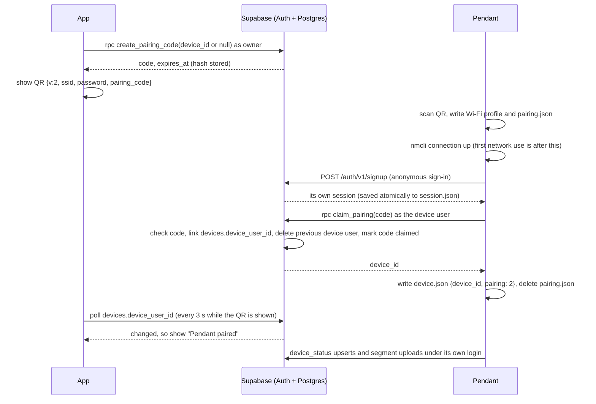
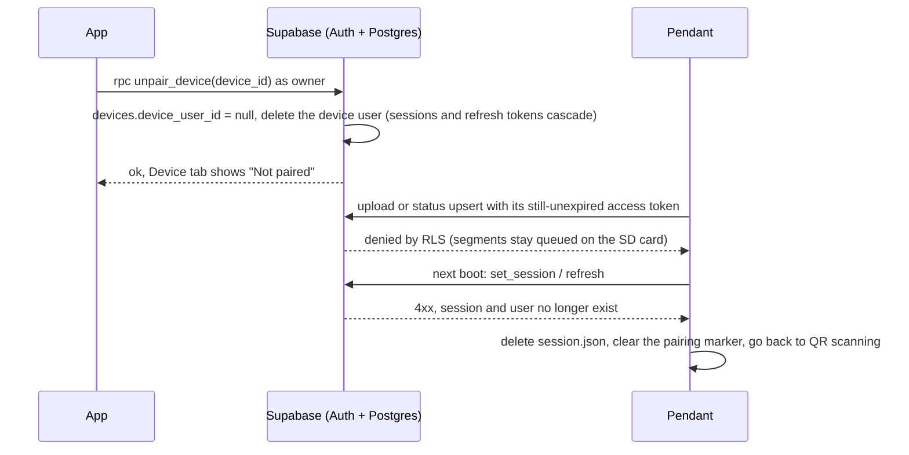

# Visio Device Pairing - Design Spec

**Date:** 2026-11-19
**Status:** Implemented on PR #105 (`fix/device-own-session`); see "As-built notes" at the end for where the build differs from the text above.
**Implementation plan:** [`../plans/2026-11-19-visio-device-pairing.md`](../plans/2026-11-19-visio-device-pairing.md)
**Supersedes:** the QR payload in [`2026-07-20-wifi-reonboard-qr-screen-design.md`](2026-07-20-wifi-reonboard-qr-screen-design.md) (payload v1).

## Problem

The app's Re-onboard QR hands the pendant the phone's own Supabase session (access token plus refresh token).
Two devices then share one session, and Supabase is built on the assumption that a session has one holder.

Refresh tokens rotate on every refresh (GoTrue v2.192, rotation on, reuse interval 10 s), and GoTrue accepts only the newest token and its immediate predecessor.
So the pendant's login dies in two ordinary situations, both reproduced against the local stack in `integration/tests/test_device_session_live.py`:

1. The phone refreshes twice (about two hours of app use).
   The pendant's copy of the refresh token is now two generations old and is rejected with "Invalid Refresh Token: Already Used".
2. The user logs out of the app (`sign_out` scope `local`).
   The shared session row is deleted, and the pendant's next boot fails with "Session from session_id claim in JWT does not exist".

Part 1 (PR #105) fixed the third failure, which was the pendant's own doing: it now saves its rotated tokens atomically (`supabase_clients._session_persister`, `wifi_onboard.write_session_credentials`).
The two failures above cannot be fixed on the pendant, because they come from sharing a session at all.
They are pinned as `xfail(strict=True)` tests, and this design makes them pass.

There is also a security cost to the current contract.
A pendant is a small object that can be lost or stolen, and today it carries a full login to its owner's account: every reel, every device, the score weights.
The QR itself, if photographed, is the same full login.

## Decision

The pendant gets its own login, using Supabase-native features and no service-role code anywhere on the pairing path.
The product owner has decided the four points below; this spec makes them concrete.

1. The QR carries the Wi-Fi SSID and password plus a one-time pairing code that the app creates.
   The code is stored hashed, expires after 10 minutes and works once.
2. The pendant joins Wi-Fi, signs in anonymously to get a session of its own, and calls a `SECURITY DEFINER` Postgres function `claim_pairing(code)`.
   That function links the pendant's auth user to the owner's device row.
3. RLS lets the pendant's user write only its own device's status row and its own storage folder.
   The app keeps reading as the owner, and the pipeline (service role) is unaffected.
4. "Remove device" in the app revokes the pendant's login.
   Re-onboarding replaces it.
   Logging out of the app no longer affects the pendant, and the pendant's login never expires by time.

## Terms

- **Owner** - the person's real Supabase account (email and password today), the `user_id` on a `devices` row.
- **Device user** - an anonymous Supabase auth user (`auth.users.is_anonymous = true`) that exists only to be one pendant's login.
- **Paired** - a `devices` row whose `device_user_id` points at a device user.
- **Pairing code** - the one-time secret that proves "the owner of account A wants this pendant on device D".

## Current state (what the code does today)

| Area | Today | Source |
|---|---|---|
| QR payload | `{ssid, password, user_access_token, user_refresh_token}` | `app/src/containers/ReonboardContainer.tsx`, `firmware/visio_recorder/wifi_onboard.py` |
| Pendant boot gate | scans a QR only when `session.json` is absent | `firmware/visio_recorder/daemon.py` `main()` |
| Pendant identity | generates its own `device_id` (`device.json`) and upserts `devices` with `user_id` = the owner it is logged in as | `device_identity.py`, `supabase_clients.SupabaseRegistration` |
| `devices` RLS | one `FOR ALL` policy, `auth.uid() = user_id`; `authenticated` has insert, update, delete on every column | `20260704120500_rls_policies.sql` |
| `device_status` RLS | one `FOR ALL` policy, `auth.uid()` = owner of the device; `authenticated` has select, insert, update | `20260704120500`, `20260710090000_grant_device_status_writes.sql` |
| `segments`, `reels` RLS | one `FOR ALL` owner policy each; grants limit `authenticated` to select plus `update (user_feedback)` on `segments` | `20260704120500` |
| Storage | `segments` and `reels` buckets, one `FOR ALL` owner policy each, keyed on the first path folder being a device the caller owns | `20260704120600_storage_buckets.sql` |
| Pipeline | service role; reads `devices (device_id, user_id, push_token)`, lists and downloads `segments/{device_id}/...`, writes `segments`, `reels`, `pipeline_dlq` | `pipeline/pipeline/adapters/supabase_store.py` |
| App | reads only: `devices`, `device_status` (plus Realtime), `segments`, `reels`, signed URLs; its one write is `segments.user_feedback` | `app/src/hooks/*` |

Every policy keys on `auth.uid()` being the owner.
That is why the pendant needs the owner's session today, and it is the thing this design changes.

Three gaps in the current app matter for this design:

- There is no "Remove device" action.
- With no `devices` row the app shows "No device linked to this account yet." and offers no way to make a QR, so a first pairing cannot start from the app.
- The app has no sign-out button, so the logout failure is reachable only through the API today; the test still pins it.

## Data model and migrations

One migration, `supabase/migrations/20261119120000_device_pairing.sql`.
The SQL below is what the migration contains; `supabase/tests/database/device_pairing.test.sql`, `rls_policies.test.sql` and `storage_buckets.test.sql` hold it in place.

### `devices.device_user_id`

```sql
alter table public.devices
  add column device_user_id uuid unique references auth.users(id) on delete set null;
```

- `unique` makes "one device user is one pendant on one device" a database fact.
  The helper `private.paired_device_id()` can then return a single value.
- `on delete set null` means deleting the device user unpairs the device and never deletes the device or its footage.
- `devices.user_id` stays the owner, so nothing the pipeline or the app reads changes meaning.

### `private` schema

Helpers and the pairing-code table live in a new `private` schema.
PostgREST exposes only `public` and `graphql_public` (`supabase/config.toml` `[api] schemas`), so nothing in `private` is reachable as a table or an RPC.

```sql
create schema if not exists private;
grant usage on schema private to authenticated, service_role;
```

### `private.device_pairing_codes`

```sql
create table private.device_pairing_codes (
  id uuid primary key default gen_random_uuid(),
  code_hash bytea not null unique,
  user_id uuid not null references auth.users(id) on delete cascade,
  device_id uuid references public.devices(device_id) on delete cascade,
  created_at timestamptz not null default now(),
  expires_at timestamptz not null,
  claimed_at timestamptz,
  claimed_by uuid references auth.users(id) on delete set null
);
create index device_pairing_codes_user_id_idx on private.device_pairing_codes (user_id);
create index device_pairing_codes_device_id_idx on private.device_pairing_codes (device_id);
create index device_pairing_codes_claimed_by_idx on private.device_pairing_codes (claimed_by);
alter table private.device_pairing_codes enable row level security;
```

- `user_id` is the owner who made the code.
- `device_id` is the device the code pairs, or null for "create a new device for this owner when claimed".
- No policies and no grants: only the `SECURITY DEFINER` functions below touch it.
- Only `sha256(code)` is stored.
  The code has 256 bits of entropy, so a fast hash is the right tool; a slow password hash would add nothing.

### Helper functions (the single source of "who may act for which device")

```sql
create function private.is_anonymous() returns boolean
  language sql stable set search_path = ''
  as $$ select coalesce((auth.jwt() ->> 'is_anonymous')::boolean, false) $$;

create function private.owned_device_ids() returns setof uuid
  language sql stable security definer set search_path = ''
  as $$ select d.device_id from public.devices d where d.user_id = (select auth.uid()) $$;

create function private.paired_device_id() returns uuid
  language sql stable security definer set search_path = ''
  as $$ select d.device_id from public.devices d where d.device_user_id = (select auth.uid()) $$;

revoke all on function private.is_anonymous(), private.owned_device_ids(), private.paired_device_id() from public;
grant execute on function private.is_anonymous(), private.owned_device_ids(), private.paired_device_id()
  to authenticated, service_role;
```

Every table and storage policy is written in terms of these two questions - "is this one of my devices" and "is this the device I am the pendant for" - so the permission rule lives in one place.
They are `SECURITY DEFINER` because a device user cannot see any `devices` row, and a policy on another table must still be able to resolve its link.
Both read the `devices` table at query time.
Authorisation is therefore never taken from a claim baked into a JWT, which is what makes revocation immediate (see "Remove device").

## RLS and storage policy changes

### Who can do what, after the change

| Object | Owner (app) | Device user (pendant) | Service role (pipeline) |
|---|---|---|---|
| `devices` | select; update `name`, `push_token`; delete | nothing | all (unchanged) |
| `device_status` | select (plus Realtime) | select, insert, update on its paired device's row | all (unchanged) |
| `segments` (table) | select; update `user_feedback` (unchanged) | nothing | all (unchanged) |
| `reels` (table) | select (unchanged) | nothing | all (unchanged) |
| `score_weights` | all on own row (unchanged) | nothing (restrictive policy) | all (unchanged) |
| `storage: segments/{device_id}/...` | select (signed URLs, downloads) | insert; select only objects this login uploaded | all (unchanged) |
| `storage: reels/{device_id}/...` | select | nothing | all (unchanged) |
| `private.device_pairing_codes` | nothing directly | nothing directly | nothing (not granted) |

Three things get tighter for the owner, deliberately:

- **No direct `insert` on `devices`.**
  `claim_pairing` is the only creator of device rows.
  This is required, not cosmetic: an anonymous user is in the `authenticated` role, and with the old grant it could insert a device with itself as `user_id` and then use the storage policies as that device's "owner".
- **`update` on `devices` limited to `name` and `push_token`.**
  Nobody can write `device_user_id` or `user_id` except the pairing functions.
- **No writes to `device_status` or to the storage buckets.**
  Those grants existed only because the pendant used to be the owner.
  The app has never written either.

### SQL

```sql
-- devices: pairing functions are the only writers of ownership and pairing columns.
revoke insert, update on public.devices from authenticated;
grant update (name, push_token) on public.devices to authenticated;
drop policy "devices_owner_access" on public.devices;
create policy "devices_owner_access" on public.devices
  for all to authenticated using ((select auth.uid()) = user_id);

-- device_status: the owner reads, the pendant writes.
drop policy "device_status_owner_access" on public.device_status;
create policy "device_status_owner_read" on public.device_status
  for select to authenticated using (device_id in (select private.owned_device_ids()));
create policy "device_status_device_read" on public.device_status
  for select to authenticated using (device_id = (select private.paired_device_id()));
create policy "device_status_device_insert" on public.device_status
  for insert to authenticated with check (device_id = (select private.paired_device_id()));
create policy "device_status_device_update" on public.device_status
  for update to authenticated
  using (device_id = (select private.paired_device_id()))
  with check (device_id = (select private.paired_device_id()));

-- segments, reels: same rule as before, now expressed through the helper.
drop policy "segments_owner_access" on public.segments;
create policy "segments_owner_access" on public.segments
  for all to authenticated using (device_id in (select private.owned_device_ids()));
drop policy "reels_owner_access" on public.reels;
create policy "reels_owner_access" on public.reels
  for all to authenticated using (device_id in (select private.owned_device_ids()));

-- A device user is never a person: it gets no score weights.
create policy "score_weights_no_anonymous" on public.score_weights
  as restrictive for all to authenticated using (not (select private.is_anonymous()));

-- storage: object keys stay {device_id}/{filename}.
drop policy "segments_bucket_owner_access" on storage.objects;
drop policy "reels_bucket_owner_access" on storage.objects;
create policy "segments_bucket_owner_read" on storage.objects
  for select to authenticated using (
    bucket_id = 'segments'
    and (storage.foldername(name))[1] in (select id::text from private.owned_device_ids() as id)
  );
create policy "reels_bucket_owner_read" on storage.objects
  for select to authenticated using (
    bucket_id = 'reels'
    and (storage.foldername(name))[1] in (select id::text from private.owned_device_ids() as id)
  );
create policy "segments_bucket_device_read" on storage.objects
  for select to authenticated using (
    bucket_id = 'segments'
    and (storage.foldername(name))[1] = (select private.paired_device_id()::text)
    and owner_id = (select auth.uid()::text)
  );
create policy "segments_bucket_device_insert" on storage.objects
  for insert to authenticated with check (
    bucket_id = 'segments'
    and (storage.foldername(name))[1] = (select private.paired_device_id()::text)
    and owner_id = (select auth.uid()::text)
  );
```

Notes on the choices:

- The `device_status` table grants (`select, insert, update` to `authenticated`) stay exactly as they are; the policies now decide which authenticated user they apply to.
  The pendant needs `select` as well as `insert` and `update`, because supabase-py's `upsert` is `INSERT ... ON CONFLICT DO UPDATE` with `return=representation`.
- How storage paths are authorised: the first folder of the object name must equal the caller's paired device id.
  The comparison is text to text, as today, so a non-uuid folder name is a mismatch and never a cast error.
- The pendant's storage `select` is scoped to `owner_id = auth.uid()`, which storage-api sets to the uploader.
  The pendant needs `select` only for its upload-idempotency check (`SupabaseStorage._stored_size`: `info`, then `list`).
  Scoping it to its own uploads means a new pairing cannot read footage uploaded under an earlier pairing, which matters if a pairing code is ever stolen (see "Security analysis").
- The pendant gets no `update` or `delete` on storage.
  Firmware uploads with `x-upsert: false` and never deletes, so it needs neither.
- Realtime is untouched: `device_status` stays in the `supabase_realtime` publication and the owner's `select` policy is what `useDeviceStatus` relies on.

## Pairing functions

Three RPCs in `public`, all `SECURITY DEFINER` with `set search_path = ''`, executable by `authenticated` only.

```sql
revoke all on function public.create_pairing_code(uuid), public.claim_pairing(text), public.unpair_device(uuid)
  from public, anon;
grant execute on function public.create_pairing_code(uuid), public.claim_pairing(text), public.unpair_device(uuid)
  to authenticated;
```

### `create_pairing_code(p_device_id uuid default null)` - called by the app

```sql
create function public.create_pairing_code(p_device_id uuid default null)
  returns table (code text, expires_at timestamptz)
  language plpgsql security definer set search_path = ''
as $$
declare
  v_uid uuid := (select auth.uid());
  v_code text;
  v_expires timestamptz := now() + interval '10 minutes';
begin
  if v_uid is null or not exists (
    select 1 from auth.users u where u.id = v_uid and not u.is_anonymous
  ) then
    raise exception 'only a signed-in account can create a pairing code' using errcode = '42501';
  end if;
  if p_device_id is not null and not exists (
    select 1 from public.devices d where d.device_id = p_device_id and d.user_id = v_uid
  ) then
    raise exception 'device not found' using errcode = '42501';
  end if;
  delete from private.device_pairing_codes c where c.user_id = v_uid and c.claimed_at is null;
  v_code := translate(encode(extensions.gen_random_bytes(32), 'base64'), '+/=', '-_');
  insert into private.device_pairing_codes (code_hash, user_id, device_id, expires_at)
  values (extensions.digest(v_code, 'sha256'), v_uid, p_device_id, v_expires);
  return query select v_code, v_expires;
end;
$$;
```

- The code is generated in the database (`pgcrypto`, already installed in `extensions`), 32 random bytes as 43 base64url characters.
  The plaintext exists only in this function's return value and on the phone's screen.
- Creating a code deletes the caller's other unclaimed codes, so an account has at most one live code.
- `p_device_id` set: "pair a pendant to this existing device", used by Re-onboard so footage history stays with the device.
- `p_device_id` null: "create a device when the pendant claims", used when the account has no device yet.

### `claim_pairing(p_code text)` - called by the pendant

```sql
create function public.claim_pairing(p_code text)
  returns uuid
  language plpgsql security definer set search_path = ''
as $$
declare
  v_uid uuid := (select auth.uid());
  v_row private.device_pairing_codes%rowtype;
  v_device_id uuid;
  v_previous uuid;
begin
  if v_uid is null or not exists (
    select 1 from auth.users u where u.id = v_uid and u.is_anonymous
  ) then
    raise exception 'only a device session can claim a pairing code' using errcode = '42501';
  end if;
  select * into v_row from private.device_pairing_codes c
    where c.code_hash = extensions.digest(p_code, 'sha256') for update;
  if found and v_row.claimed_by = v_uid then
    return v_row.device_id;
  end if;
  if not found or v_row.claimed_at is not null or v_row.expires_at <= now() then
    raise exception 'invalid pairing code' using errcode = 'P0001';
  end if;
  if exists (select 1 from public.devices d where d.device_user_id = v_uid) then
    raise exception 'this device session is already paired' using errcode = 'P0001';
  end if;
  if v_row.device_id is null then
    insert into public.devices (user_id, name, device_user_id)
    values (v_row.user_id, 'visio-pendant', v_uid)
    returning device_id into v_device_id;
  else
    select d.device_user_id into v_previous from public.devices d
      where d.device_id = v_row.device_id and d.user_id = v_row.user_id for update;
    if not found then
      raise exception 'invalid pairing code' using errcode = 'P0001';
    end if;
    v_device_id := v_row.device_id;
    update public.devices set device_user_id = v_uid where device_id = v_device_id;
    if v_previous is not null then
      delete from auth.users u where u.id = v_previous and u.is_anonymous;
    end if;
  end if;
  update private.device_pairing_codes
    set claimed_at = now(), claimed_by = v_uid, device_id = v_device_id
    where id = v_row.id;
  return v_device_id;
end;
$$;
```

- It takes only the code.
  The pendant never names a `device_id`; the function returns the one the owner chose, and the pendant adopts it.
  A pendant therefore cannot claim somebody else's device by guessing or knowing its id.
- Single use: the row is locked `for update`, and a claimed code is rejected for everyone except the device user that claimed it.
- Idempotent for that one caller: a pendant that lost power after the claim committed but before it saved the result can ask again and gets the same `device_id`.
- Unknown, expired and already-used codes return the same error, so a caller learns nothing about which codes exist.
- Re-pairing replaces: the device's previous device user is deleted in the same transaction, so two pendant logins never hold one device.

### `unpair_device(p_device_id uuid)` - called by the app ("Remove device")

```sql
create function public.unpair_device(p_device_id uuid)
  returns void
  language plpgsql security definer set search_path = ''
as $$
declare
  v_uid uuid := (select auth.uid());
  v_previous uuid;
begin
  select d.device_user_id into v_previous from public.devices d
    where d.device_id = p_device_id and d.user_id = v_uid for update;
  if not found then
    raise exception 'device not found' using errcode = '42501';
  end if;
  update public.devices set device_user_id = null where device_id = p_device_id;
  delete from private.device_pairing_codes c where c.device_id = p_device_id and c.claimed_at is null;
  if v_previous is not null then
    delete from auth.users u where u.id = v_previous and u.is_anonymous;
  end if;
end;
$$;
```

- Clearing `device_user_id` is the revocation.
  Every policy resolves the link at query time, so the pendant's next request is denied even though its access token stays cryptographically valid for up to an hour.
- Deleting the anonymous auth user cascades to `auth.sessions` and `auth.refresh_tokens`, so the pendant can never refresh again.
- The `is_anonymous` guard means these functions can never delete a real account.
- The device row, its `segments` and `reels` rows and its stored footage are all kept.
  See "Open questions" for the alternative.

### Housekeeping

```sql
create function private.purge_stale_pairing_state() returns void
  language sql security definer set search_path = ''
as $$
  delete from private.device_pairing_codes c
    where c.expires_at < now() - interval '1 day';
  delete from auth.users u
    where u.is_anonymous
      and u.created_at < now() - interval '1 day'
      and not exists (select 1 from public.devices d where d.device_user_id = u.id);
$$;
revoke all on function private.purge_stale_pairing_state() from public;

create extension if not exists pg_cron with schema pg_catalog;
select cron.schedule(
  'purge-stale-pairing-state', '17 3 * * *',
  $$select private.purge_stale_pairing_state()$$
);
```

An anonymous user that never completes a pairing (a failed attempt, or somebody poking the public sign-in endpoint) has no permissions, but it would sit in `auth.users` forever.
The daily job deletes any anonymous user older than a day that no device points at.
`pg_cron` ships in the Supabase Postgres image (available locally and on the hosted project) and keeps this out of the pipeline, which stays unaware of pairing.
This relies on an invariant: **anonymous sign-in is used in this project only for pendants.**
If the app ever offers anonymous accounts to people, this job must be narrowed first.

## Flows

### Pair (first pairing and re-onboarding are the same flow)



### Remove device



### The other cases

- **App logout or phone refresh.**
  The phone's session and the pendant's session are different rows for different users.
  Nothing the phone does to its own session touches the pendant.
- **Re-onboard the same device (new Wi-Fi, or a replacement pendant).**
  The app passes its current `device_id` to `create_pairing_code`; `claim_pairing` swaps the device user and deletes the old one.
  Footage history stays on the device.
- **Re-onboard to another account.**
  Account B makes a code; the pendant claims it and adopts B's `device_id`.
  The pendant's old login was already deleted from the pendant when it went back to scanning.
  Account A's device row keeps pointing at a device user nobody holds tokens for, until A taps "Remove device" or re-pairs; it can do nothing in the meantime because nothing holds its tokens.
- **Login lifetime.**
  GoTrue refresh tokens do not expire by time, and `supabase/config.toml` sets no `[auth.sessions]` timebox or inactivity timeout.
  A pendant left in a drawer for months refreshes normally when it next boots.
  The hosted project must keep those two settings unset (see "Rollout").

## QR payload v2

```json
{
  "v": 2,
  "ssid": "string",
  "password": "string",
  "pairing_code": "43 base64url characters"
}
```

- `v` is a JSON number and must equal `2`.
- `ssid` and `password` keep today's validation (`wifi_onboard._validate_credentials`).
- `pairing_code` is a non-empty string; firmware does not interpret it.
- The Supabase URL and anon key are not in the QR; the pendant already has them in `/etc/visio-recorder.env`.

The payload shrinks from about 1,800 characters (two JWTs) to under 150, so the QR is far less dense and scans more reliably.
The app can drop the `ecl="L"` workaround and use the library default.

Version skew:

| App | Firmware | Result |
|---|---|---|
| old (v1 payload) | new | Firmware rejects the scan as a legacy payload, logs "QR is from an older app version; update the app", and keeps scanning. It must never accept a v1 payload: doing so would put the owner's session back on the pendant. |
| new (v2 payload) | old | Old firmware requires `user_access_token`, so the scan is a decode error and it keeps scanning until its 60 attempts run out. No harm done, no pairing. |
| any future `v` | new | Rejected with "unsupported QR version"; keeps scanning. |

There is one test pendant and it is re-onboarded once, so firmware does not carry a v1 compatibility path.

## Firmware changes

### On-disk state (`VISIO_DATA_DIR`, default `/var/lib/visio-recorder`)

| File | Content | Written by |
|---|---|---|
| `pairing.json` | `{"pairing_code": "..."}`, mode 0600, present only between a good scan and a finished claim | onboarding |
| `session.json` | `{"access_token", "refresh_token"}` of the device user; shape unchanged from part 1 | the part 1 session persister |
| `device.json` | `{"device_id": "<from claim_pairing>", "pairing": 2}` | pairing |

The boot gate changes from "`session.json` exists" to a three-state check:

| State | Condition | Boot does |
|---|---|---|
| `PENDING` | `pairing.json` exists | activate Wi-Fi, finish pairing, then continue as paired |
| `PAIRED` | `device.json` has `"pairing": 2` and `session.json` exists | today's normal boot |
| `UNPAIRED` | anything else | delete any `session.json`, scan for a QR |

- A pendant onboarded under the old contract has a `device.json` without the marker, so new firmware treats it as `UNPAIRED`, deletes the owner's session from the SD card and waits for a QR.
  That is the whole migration, with no SSH step.
- Entering the scan always deletes `session.json` first.
  So a `session.json` seen in `PENDING` can only be the anonymous session from this pairing attempt, and a restart resumes with it instead of signing in again.
  This keeps a crash-looping pendant from burning the anonymous sign-in rate limit.

### Pairing sequence (`firmware/visio_recorder/pairing.py`, new)

1. `run_onboarding` parses the v2 payload, writes the NetworkManager keyfile and `pairing.json`.
   Nothing here touches the network, so a first boot with no connectivity behaves as today.
2. `activate_connection` brings Wi-Fi up; on failure the daemon shows the Critical LED and exits 1, exactly as today.
   systemd restarts it into `PENDING`, which retries.
3. `complete_pairing` creates a Supabase client and registers the part 1 `_session_persister` before anything else.
   With no `session.json` it calls `client.auth.sign_in_anonymously()`; the persister saves the new session through the same atomic write as every later rotation.
   With a `session.json` (a resumed attempt) it calls `set_session` instead.
4. It calls `client.rpc("claim_pairing", {"p_code": code})`, writes `device.json` atomically, then deletes `pairing.json`.
   A power cut between those two writes is safe: the next boot is `PENDING`, claims again, and the function returns the same `device_id`.

Failure handling:

| Failure | Meaning | Pendant does |
|---|---|---|
| network error, timeout, 5xx, 429 | not reachable yet | exit 1; systemd restarts into `PENDING` and retries |
| 4xx from `claim_pairing` | code wrong, expired, or used | delete `pairing.json` and `session.json`, Critical LED, exit 1; next boot scans again |
| 4xx from anonymous sign-in other than 429 | anonymous sign-ins disabled on the project | log an explicit "enable anonymous sign-ins" error, exit 1, stay `PENDING` |

### Paired boot

- `build_supabase_clients` keeps its part 1 behaviour: register the persister, then `set_session`.
- New: a definite rejection from `set_session` (an `AuthApiError` with a 4xx status other than 429) means the login was revoked or replaced.
  The daemon deletes `session.json`, rewrites `device.json` without the marker and exits 1, so the next boot scans for a QR.
  Network errors and 5xx are not rejections; they keep today's behaviour (exit 1, retry on restart) and never unpair.
- `load_or_create_device_id`, `register_device`, `SupabaseRegistration` and the `device_registered` marker are removed.
  The device id comes from `claim_pairing`, and the pendant no longer writes `devices` at all.

### Upload edge case created by uploader-scoped reads

`SupabaseStorage.upload` checks for an existing object before sending.
After a re-pair, an object uploaded by the previous device user is invisible to the new one, so the check says "absent" and the upload is answered with 409 Duplicate.
This needs a power cut between an upload and its dequeue, followed by a re-pair, so it is rare, but it would otherwise retry forever.
The adapter raises a distinct `ObjectAlreadyStoredError` for a 409, and the queue moves the file to the existing `rejected/` directory (kept for manual recovery, counted in `device_status.segments_rejected`), the same path an unsplittable oversized segment takes.

### Unchanged

- Part 1's refresh-token persistence applies as is; it now protects the pendant's own session instead of a borrowed one.
- Recording never depends on pairing state once paired; uploads that fail stay queued.
- Mid-run revocation is not detected: after "Remove device" a running pendant keeps recording, its uploads fail and queue, the LED latches Critical after three failures, and the next boot returns it to scanning.

## App changes

- **`ReonboardContainer`** calls `client.rpc('create_pairing_code', { p_device_id })` instead of `client.auth.getSession()`, and builds the v2 payload.
  The RPC is typed through the generated `Database['public']['Functions']`, so a renamed argument is a `tsc` error.
- **`ReonboardScreen`** gains two steps, `paired` and `expired`.
  While `ready`, the container polls `devices` every 3 s; when `device_user_id` differs from its value before the code was made (or a device row appears), it shows "Pendant paired".
  When `expires_at` passes it shows "This code has expired" with a "Generate a new code" button.
  The privacy hint becomes "This code contains your Wi-Fi password and a one-time pairing code. Only show it to your Visio pendant's camera."
- **First pairing.**
  `SignedInApp`'s `device.kind === 'none'` branch renders a "Set up your Visio" screen that opens the same pairing screen with no device id.
  `useDevice` gains a `refresh()` so the tabs appear once the pendant has claimed.
- **Remove device.**
  The Device tab gets a "Remove device" button behind a confirmation dialog ("The pendant will be signed out. Your footage stays in your account.").
  It calls `client.rpc('unpair_device', { p_device_id })`.
- **Pairing status.**
  `useDevice` also selects `device_user_id` and exposes `paired: boolean`; the Device tab shows "Not paired" with a "Pair pendant" button when it is false.
- **Logout** needs no change: `signOut()` ends only the phone's session.

## Pipeline changes

None in code.
The pipeline uses the service role, which bypasses RLS and keeps its existing table grants, and it reads `devices.user_id`, which is still the owner.
`integration/tests/fixtures/public_schema.json` is regenerated because `devices` gains a column.

## Spec-first and generated clients

The migration is the specification of the pairing API.

- The app's client is generated: `scripts/gen-db-types.sh` regenerates `app/src/generated/database.ts`, including the three RPC signatures, and CI fails on drift.
- Firmware is Python and has no generated client today.
  `scripts/gen-db-types.sh` is extended to add a `functions` section (name, argument names and types, return type) to `integration/tests/fixtures/public_schema.json`, and a contract test asserts that the RPC name and argument names firmware sends match it.
  That gives the Python side the same "migration changed, build goes red" property the app has.
- Permission logic lives only in the database (policies and the two helpers).
  Neither the app nor firmware re-implements a permission check; they call and handle a refusal.

## Security analysis

| Threat | Outcome |
|---|---|
| **Stolen or lost pendant** | It holds a login that can write one device's status row, upload into one folder and read back its own uploads. It cannot read reels, other devices, or account data. "Remove device" kills it. Today the same theft yields the owner's whole account. |
| **Photographed QR** | The thief gets the Wi-Fi password (as today) and a code that works once within 10 minutes. If the thief claims first, the real pendant's claim fails (Critical LED) and the app shows "Pendant paired" for a pendant that is not; "Remove device" revokes the thief. Because storage reads are scoped to the uploader, the thief's login can read none of the existing footage. It can upload junk into the device folder until removed. Today a photographed QR is a full account takeover. |
| **Pairing-code brute force** | 256 bits of entropy. No attempt limiter is needed or added; guessing is infeasible and a wrong guess reveals nothing (one generic error). At most one live code per account, each valid 10 minutes. |
| **Replay of a used code** | Rejected for every caller except the device user that claimed it, for whom it is an idempotent read of the same `device_id`. |
| **A pendant claiming someone else's `device_id`** | Not expressible. `claim_pairing` takes only a code; the device comes from the code's row, which only the device's owner could have created (`create_pairing_code` checks ownership). |
| **An account pairing a pendant to a device it does not own** | `create_pairing_code` refuses a `p_device_id` the caller does not own. |
| **Anonymous sign-in abuse** | Anyone with the anon key can create anonymous users. Such a user can read and write nothing: no device link, no `devices` insert grant, restrictive policy on `score_weights`, and it cannot create pairing codes. GoTrue limits anonymous sign-ins per IP (`[auth.rate_limit] anonymous_users`, 30 per hour on the hosted project), and the daily job deletes unlinked anonymous users after a day. |
| **CAPTCHA** | Must stay off. Supabase applies CAPTCHA to anonymous sign-in, and a pendant cannot solve one. The rate limit plus "anonymous users have no permissions" is the control instead. |
| **Owner tampering with pairing columns** | Column grants stop an owner writing `device_user_id` or `user_id`, so nobody can attach an arbitrary auth user to a device or block another pendant by squatting on its user id. |
| **A device user upgrading itself to a real account** | An anonymous user can attach an email to itself through the Auth API. It stays linked until removed, with the same narrow permissions. `unpair_device` still revokes it by clearing the link; only the "delete the auth user" step is skipped, by design, because the function never deletes a non-anonymous user. |
| **Access token outliving revocation** | Access tokens last an hour and cannot be recalled. Every policy looks the link up at query time, so a revoked pendant is denied immediately at Postgres and Storage regardless of its token. |
| **`SECURITY DEFINER` risks** | Every function sets `search_path = ''` and schema-qualifies each reference; execute is revoked from `public` and `anon`. The functions take the caller from `auth.uid()` and never from an argument. |
| **Hash at rest** | A database leak exposes only SHA-256 hashes of 256-bit codes that expire in 10 minutes. |

Accepted, stated plainly:

- The Wi-Fi password is still in the QR in clear text.
  That is unchanged and inherent to the mechanism.
- Unuploaded footage on the SD card goes to whichever account the pendant is next paired to.
  Whoever holds the pendant holds the SD card, so this adds no exposure.

## Testing strategy

| Layer | What it proves | Where |
|---|---|---|
| pgTAP | The permission matrix above, row by row: owner, device user, unpaired anonymous user, other account. Each function's happy path and each refusal (expired, reused, wrong owner, anonymous creator, non-anonymous claimer). Re-pair deletes the previous device user. `unpair_device` never deletes a real account. The purge keeps linked device users. Grants: no `insert` on `devices`, column-limited `update`, no access to `private`. | `supabase/tests/database/device_pairing.test.sql` (new); `rls_policies.test.sql`, `storage_buckets.test.sql` (updated) |
| Firmware unit | v2 parse and the v1 and unknown-version rejections; the three boot states; legacy state treated as unpaired; pairing sequence order, resume and idempotent re-claim; each failure row above; revoked login at boot returns to scanning; network failure does not unpair; 409 goes to `rejected/`. All through the existing fakes, no mocks. | `firmware/tests/test_wifi_onboard.py`, `test_onboarding.py`, `test_pairing.py` (new), `test_supabase_clients.py`, `test_device_identity.py`, `test_daemon.py` |
| App jest | The container calls `create_pairing_code` with the device id and emits exactly `{v, ssid, password, pairing_code}`; paired and expired steps; RPC error goes to the error step; Remove device confirms then calls `unpair_device`; the no-device state offers setup. | `app/__tests__/containers/ReonboardContainer.test.tsx`, `screens/ReonboardScreen.test.tsx`, `containers/DeviceContainer.test.tsx`, `screens/DeviceScreen.test.tsx`, `hooks/useDevice.test.tsx`, `App.test.tsx` |
| Contract | Firmware's RPC name and argument names match the generated function fixture; the QR payload the app test asserts is the one firmware's parser accepts. | `integration/tests/test_row_schema_contract.py` (extended) |
| Live integration | The real thing against GoTrue, PostgREST and storage-api. | `integration/tests/test_device_session_live.py` and the two upload suites |

The live suite is where the two pinned failures turn green.
`_onboard` in `test_device_session_live.py` is rewritten to do what the app and pendant now do: the phone client calls `create_pairing_code`, the payload goes through `parse_onboarding_qr_payload`, and the pendant side runs the real `complete_pairing`.
The `xfail` marks are then removed from:

- `test_the_phone_refreshing_does_not_cost_the_pendant_its_login`
- `test_logging_out_of_the_app_does_not_log_the_pendant_out`

New live tests in the same file:

- the paired pendant uploads a segment and upserts its status, and the owner reads both;
- the pendant cannot upload into another device's folder, cannot read reels, and cannot read `devices`;
- "Remove device" makes the pendant's next boot fail with a definite rejection, and its still-valid access token is refused by storage;
- re-pairing the same device makes the first pendant's login fail and the second one work;
- a used code is refused for a second anonymous user (expiry cannot be aged through the public API, so pgTAP covers it);
- an anonymous user with no pairing can do nothing.

`test_firmware_upload_live.py` and `test_storage_ingestion_live.py` upload as the owner today.
They move to a shared `paired_device` fixture in `integration/tests/conftest.py` that pairs through the real RPCs, because the owner can no longer write to storage.

The local stack needs `enable_anonymous_sign_ins = true`, and `[auth.rate_limit] anonymous_users` raised well above 30, since every pairing in the suite is an anonymous sign-in from one IP.

## Rollout and manual steps

Order matters, because the migration takes away the owner's write access that an un-migrated pendant depends on.

1. **Hosted project, before deploying (owner, in the dashboard).**
   Authentication, Sign In / Providers: turn on "Allow anonymous sign-ins".
   Confirm "Allow new users to sign up" is on (anonymous sign-in is refused when sign-ups are disabled).
   Leave CAPTCHA protection off.
   Authentication, Rate Limits: leave anonymous sign-ins at the default 30 per hour per IP.
   Authentication, Sessions: confirm "Time-box user sessions" and "Inactivity timeout" are unset.
2. **Apply the migration** to the hosted database (it creates the `pg_cron` extension and the daily job).
3. **Ship firmware and the app together.**
4. **Re-onboard the test pendant once.**
   On its first boot with the new firmware it deletes the old session and scans.
   In the app, Device tab, Re-onboard: enter Wi-Fi, show the QR; the app reports "Pendant paired".
   Footage history stays, because the code targets the existing device.
5. **Verify.**
   Authentication, Users shows one anonymous user; `devices.device_user_id` is set; a segment arrives; logging out of the app and back in leaves the pendant uploading.

Between steps 2 and 4 the pendant cannot upload.
Its segments queue on the SD card and upload after pairing, so nothing is lost.

The legacy pendant's copy of the owner's phone session is deleted from the pendant's disk on its first new boot, but that session stays valid on the server until the phone signs out.
Anyone who copied the SD card before then still holds a working login to the owner's account.
After re-onboarding, sign out of the app and sign back in on the phone, which ends that shared session server-side.

Rollback: the migration is reversible by a follow-up migration that restores the five dropped policies and the two grants; the added column, table and functions can stay unused.
Firmware and app roll back together with it, since v1 and v2 payloads are mutually unreadable.

## Out of scope

- A physical way to put an already-paired pendant back into QR scanning (see "Open questions").
- Deleting a device and its footage from the app.
- More than one device per account in the app's UI; the data model already allows it.
- Detecting revocation while the daemon is running.
- A sign-out button in the app.

## Open questions

1. **What "Remove device" removes.**
   This design revokes the pendant's login and keeps the device row and all footage, and the Device tab then shows "Not paired".
   The alternative is to also delete the device, its rows and its stored footage, which is destructive and needs storage cleanup that only the service role can do today.
   Recommendation: revoke only, as designed.
2. **Re-onboarding a paired pendant whose Wi-Fi is gone.**
   A paired pendant scans for a QR only after Supabase tells it its login is dead.
   If the Wi-Fi it knows no longer exists (new router, new home, or a sale to another account), it can never hear that, so it never scans; today's firmware has the same limitation.
   Recommendation: a follow-up that enters scanning from a button gesture, which deletes `session.json` locally; the pendant spec's planned hold ladder now gives this to a hold of 10 s or more from Stopped (a 5-10 s hold is the graceful power-off).
   Until then the path is `sudo rm /var/lib/visio-recorder/session.json` over SSH and a restart.
3. **Storage-api and `owner_id` in the insert check.**
   Resolved: kept.
   `test_the_paired_pendant_uploads_and_reports_and_the_owner_reads_both` in `integration/tests/test_device_session_live.py` uploads through storage-api as a real anonymous device user, and the insert policy's `owner_id = auth.uid()` clause passes, so no fallback was needed.

Questions 1 and 2 were decided by the product owner: "Remove device" is revoke-only as designed, and re-onboarding a paired pendant whose Wi-Fi is gone stays out of scope (issues #113 and #114).

## As-built notes

Where the implementation differs from, or adds to, the text above:

- **Refused claim, by SQLSTATE.**
  supabase-py does not expose the HTTP status of a PostgREST error, so firmware treats a claim as definitely refused only when it fails with the errors `claim_pairing` raises itself (`P0001`, `42501`).
  Anything else, including PostgREST's own `PGRST` codes (for example the function missing because the migration is not applied yet) and a proxy's 5xx, is retried on the next boot instead of clearing the code.
- **A resumed session that is gone.**
  If the anonymous session saved during an unfinished pairing is refused with a definite 4xx (the daily purge deletes an unlinked anonymous user after a day), firmware deletes it and signs in anonymously again, keeping the code.
- **An unreadable `pairing.json`** counts as `UNPAIRED`, since there is no code to resume with; the scan path deletes it.
- **v1 detection.**
  A payload with neither `v` nor `pairing_code` is reported as "QR is from an older app version"; any other missing or wrong `v` is "unsupported QR version".
  Both keep scanning, as designed.
- **409 handling** applies to every queued file, flag markers included, through the same `rejected/` path.
- **App confirmation** for "Remove device" is an inline card on the Device tab rather than a native alert, because React Native Web's `Alert` has no buttons.
- **App pairing screens** gained a title, a Cancel button on the form, expired and error steps, and a "Close" button (instead of "Done") while the QR is still waiting for the pendant.
  The QR sits on a white quiet zone so the dark theme does not touch the modules.
- **Not paired** shows the device's last status report in muted text under the "Pair pendant" card, so footage counts stay visible after a removal.
- **Integration helpers** for pairing live in `integration/tests/pendant.py`; `integration/tests/__init__.py` makes the suite a package so tests can import them.
- **Live app test.** `app/__tests__/hooks/useDeviceStatus.live.test.tsx` now writes `device_status` as a paired pendant, since the owner no longer can.
- **Restoring a saved login never trusts the pendant's clock.**
  A Pi has no RTC, so before NTP sync its clock can be hours behind; `set_session` then calls a really expired access token valid, GoTrue answers 403 `bad_jwt` "token is expired", and the first build treated that as a revocation and unpaired a healthy pendant.
  The paired boot and the pairing resume (`session_store.restore_session`) now always run the refresh-token grant, which only the server judges.
  They unpair only when it is refused with `refresh_token_not_found`, `refresh_token_already_used`, `session_not_found`, `session_expired`, `user_not_found` or `user_banned`; any other 4xx, a 429, a 5xx or a network error is retried.
  Remove device and a re-pair both answer `refresh_token_not_found` (reproduced against the local stack).
- **An unreadable `session.json`** (empty, not JSON, not an object, a missing, empty or non-string token) counts as no login: the boot gate treats it as `UNPAIRED` and scans, instead of crash-looping on a parse error.
- **One client per boot.**
  `complete_pairing` returns its signed-in client and the boot builds the storage and status adapters from it, so a pairing boot runs one refresher (its `SessionKeeper`) and one `session.json` persister.
  Atomic writes (`private_files.write_private_text_atomic`) use a unique `O_EXCL` temp name per write and are serialised per path across the process.
- **A pending pairing gives up on Wi-Fi.**
  `pairing.json` also carries `failed_activations`; after `MAX_FAILED_PENDING_ACTIVATIONS` (3) boots in a row whose Wi-Fi activation failed, it is deleted and the next boot scans, so a mistyped Wi-Fi password cannot strand the pendant.
  A boot that connects resets the count.
- **The firmware owns token refresh, on demand (issue #134).**
  supabase_auth 2.34.1's auto-refresh timer retried a failed refresh for only about 100 s in all and was then never rescheduled, and supabase-py does not refresh before a request, so a pendant off Wi-Fi when the hourly refresh fell due sent an expired token until the daemon restarted (reproduced against the local stack in `integration/tests/test_offline_refresh_live.py`).
  The pendant's client is now made with `auto_refresh_token=False` (`session_store.create_pendant_client`), and `session_store.SessionKeeper`, the client's one auth listener, is the only refresher.
  Before every storage upload and `device_status` upsert it runs the refresh-token grant when the access token is within 60 s of expiry, judged by the lifetime GoTrue gave it counted on the monotonic clock from its arrival, never by the wall clock.
  A request refused for an expired token anyway marks the login stale and is sent once more after a refresh.
  One re-entrant lock serialises refreshes, so concurrent callers refresh once, and every rotated token is persisted through the same `session.json` writer.
  A refresh that fails for any other reason than a definite refusal (network, 429, 5xx) sends nothing, leaves the file queued as `deferred`, which neither counts towards nor clears the Critical LED, and is not retried before `RetryBackoff` (30 s doubling to 8 minutes).
  A refusal with one of `REFUSED_LOGIN_CODES` ends the run, unpairs and exits 1 so the next boot scans, as a revoked login at boot does.
- **Boot order with the battery and LED work (merged from main, 2026-11).**
  `main()` runs the debounced battery boot check first, and a confirmed halt powers the pendant off before the pairing state is read, so a flat unpaired or pending pendant never scans or signs in.
  Only then does `pair_and_connect` run the pairing gate, with every LED write (the Critical flash for a failed Wi-Fi activation, a refused code or a revoked login) going through the process's one `LedController`.
  The flag button and its `FlagUploadWorker` start after the gate and take the storage adapter built on the gate's one client, as do the segment uploader and the status reporter.
  Every early exit (battery power-off, back to scanning, Wi-Fi failure) closes the `LedController`, and none of them has started the flag worker yet.
- **QR expiry is timed by the server's lifetime.**
  `create_pairing_code` also returns `expires_in` (seconds), and the app times the QR from the moment the code arrived instead of comparing `expires_at` with the phone's clock.
- **The app forgets the code and the Wi-Fi password** as soon as the QR is no longer shown (paired, expired, error or closed).
  The database has no call that retires an unclaimed code without unpairing, so closing early only clears state; the code expires on its own and the next one replaces it.
  "Make a new code" after expiry returns to the form with the SSID kept.
